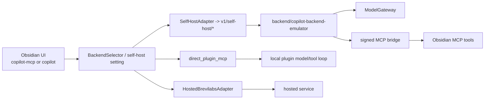

# Architecture Notes

## Final Boundary

## Current Preferred Paths

Preferred self-host boundary:
- `copilot-mcp -> SelfHostAdapter -> v1/self-host/* -> backend emulator -> bridge -> MCP tools`

Preserved comparison path:
- `copilot-mcp -> direct_plugin_mcp -> plugin-side model/tool loop -> MCP bridge`

Secondary official-plugin compatibility path:
- `copilot -> Miyo / self-host visible /v0/* -> backend emulator alias layer -> real Miyo`

Hosted isolation:
- `copilot-mcp -> HostedBrevilabsAdapter -> hosted service`

## Important Rules

- `backendMode=self_host` does not silently fall back to hosted mode.
- `selfHostExecutionMode=exact_backend_emulator` routes the whole turn through the emulator.
- `selfHostExecutionMode=direct_plugin_mcp` preserves the existing local debug path.
- hosted mode remains isolated and optional.

## Main Files

Fork files:
- `/Users/trevorrobey/THE Copilot in Obsidian Everything/repos/obsidian-copilot-mcp/src/backend/SelfHostAdapter.ts`
- `/Users/trevorrobey/THE Copilot in Obsidian Everything/repos/obsidian-copilot-mcp/src/backend/BackendSelector.ts`
- `/Users/trevorrobey/THE Copilot in Obsidian Everything/repos/obsidian-copilot-mcp/src/backend/selfHostContract.ts`
- `/Users/trevorrobey/THE Copilot in Obsidian Everything/repos/obsidian-copilot-mcp/src/LLMProviders/chainRunner/SelfHostEmulatorChainRunner.ts`

Backend files:
- `/Users/trevorrobey/THE Copilot in Obsidian Everything/backend/copilot-backend-emulator/src/server.ts`
- `/Users/trevorrobey/THE Copilot in Obsidian Everything/backend/copilot-backend-emulator/src/services/SelfHostExecutionEngine.ts`
- `/Users/trevorrobey/THE Copilot in Obsidian Everything/backend/copilot-backend-emulator/src/services/ModelGateway.ts`
- `/Users/trevorrobey/THE Copilot in Obsidian Everything/backend/copilot-backend-emulator/src/services/McpOrchestrator.ts`
- `/Users/trevorrobey/THE Copilot in Obsidian Everything/backend/copilot-backend-emulator/src/services/CompatibilityAliasService.ts`
- `/Users/trevorrobey/THE Copilot in Obsidian Everything/backend/copilot-backend-emulator/src/services/MiyoCompatibilityService.ts`
- `/Users/trevorrobey/THE Copilot in Obsidian Everything/backend/copilot-backend-emulator/src/adapters/MiyoCompatibilityClient.ts`

Contract docs:
- `/Users/trevorrobey/THE Copilot in Obsidian Everything/docs/SELF_HOST_CONTRACT.md`
- `/Users/trevorrobey/THE Copilot in Obsidian Everything/docs/SELF_HOST_LOGIC_MAP.md`
- `/Users/trevorrobey/THE Copilot in Obsidian Everything/docs/SELF_HOST_COMPAT_MATRIX.md`
- `/Users/trevorrobey/THE Copilot in Obsidian Everything/docs/OFFICIAL_MIYO_CONTRACT.md`
