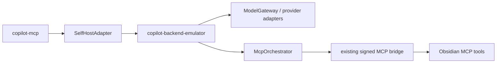
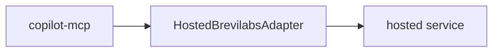

# Backend Emulator Architecture

## Boundary

Hosted remains separate:

## Backend Project

Root:
- `/Users/trevorrobey/THE Copilot in Obsidian Everything/backend/copilot-backend-emulator`

Primary responsibilities:
- own the full self-host turn in `exact_backend_emulator` mode
- preserve plugin-visible response semantics
- reuse the proven bridge transport instead of re-implementing MCP backends

## Main Components

Routes:
- `src/routes/health.ts`
- `src/routes/selfHostContract.ts`
- `src/routes/compatAliases.ts`

Core services:
- `SelfHostContractInventory`
- `CopilotRequestParser`
- `SelfHostExecutionEngine`
- `ToolRouter`
- `McpOrchestrator`
- `ResponseTransformer`
- `ModelGateway`

Adapters:
- `BridgeMcpClient`
- `AuthAdapter`
- `CopilotResponseAdapter`
- `OpenAICompatibleAdapter`
- `OllamaAdapter`
- `LMStudioAdapter`

Transport:
- `HttpMcpTransport`

## Execution Summary

1. Validate auth and parse canonical request (including lane stream policy).
2. Run pre-flight vault intent check and optionally call `miyo_search_context`.
3. Ask the selected server-side model to plan additional tool usage.
4. Execute MCP tools through the existing bridge when required.
5. Feed tool results back into the selected model.
6. Return:
   - fully rendered assistant content
   - reasoning/tool trace
   - token usage
   - canonical success or error envelope

## Deliberate Limits

- No hosted Brevilabs emulation.
- No silent hosted fallback.
- No replacement of the existing direct plugin MCP path.
- No unsafe implementation of undocumented official/Miyo routes.
