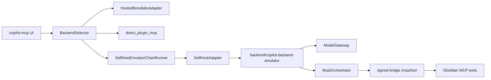

# Self-Host Logic Map

Date: 2026-03-19

## Current Modes

## Exact Mode Call Graph

UI action to final render:

1. User sends a chat message in `copilot-mcp`.
2. `ChatManager.sendMessage()` builds the processed user message and context envelope.
3. `Chat.tsx` fetches the LLM message and calls `getAIResponse(...)`.
4. `ChainManager.runChain()` selects `SelfHostEmulatorChainRunner` when:
   - `backendMode=self_host`
   - `selfHostExecutionMode=exact_backend_emulator`
5. `SelfHostEmulatorChainRunner` builds the canonical request:
   - normalized messages
   - current selected model/provider config
   - `runtimeLane` metadata (`production_official | fork_dev | raycast`)
   - MCP tool bindings
   - retrieval sources for Vault QA
   - project metadata
6. `SelfHostAdapter` sends either:
   - `POST /v1/self-host/agent-turn`
   - `POST /v1/self-host/agent-turn/stream`
7. `CopilotRequestParser` validates the canonical schema.
   - injects default model config if omitted
   - hard-gates stream policy by lane (`fork_dev` only)
8. `SelfHostExecutionEngine` owns the full turn:
   - pre-flight vault intent check (may invoke `miyo_search_context`)
   - plan tool use with `ModelGateway`
   - resolve tool bindings with `ToolRouter`
   - execute MCP calls through `McpOrchestrator`
   - run final model answer generation with `ModelGateway`
   - shape response with `ResponseTransformer`
9. `SelfHostAdapter` parses SSE or JSON.
10. `BaseChainRunner.handleResponse()` adds the final AI message with `responseMetadata`.
11. UI renders:
   - `assistant.content` for visible chat text
   - `<!--AGENT_REASONING:...-->` markers for the existing reasoning UI path
   - `responseMetadata.tokenUsage` for token reporting

## Direct Plugin MCP Logic

This remains preserved for debugging and comparison.

Flow:
- UI -> `ChatManager` -> normal chain runner (`AutonomousAgentChainRunner`, `CopilotPlusChainRunner`, `LLMChainRunner`, or `VaultQAChainRunner`) -> local plugin model/tool loop -> `McpToolProvider`

Visible differences from exact mode:
- model loop runs inside the plugin
- built-in tool binding stays local
- MCP execution happens from the plugin instead of from the backend emulator

## Hosted Logic

Hosted mode remains isolated:
- UI -> `BackendSelector` -> `HostedBrevilabsAdapter` -> hosted service

No hosted fallback exists from self-host exact mode.

## Tool Invocation Expectations

Exact mode currently exposes MCP tools only.

Tool flow:
1. Plugin sends `tools[]` as canonical MCP bindings.
2. Pre-flight checker may invoke `miyo_search_context` before planning for vault-intent messages.
3. Backend planner decides whether additional tools are needed.
3. `ToolRouter` resolves the runtime name to a bridge tool.
4. `McpOrchestrator` builds bridge input payloads.
5. Bridge returns `{ ok, data|error, meta }`.
6. `ResponseTransformer` converts tool outcomes into:
   - reasoning summaries
   - structured `assistant.trace.toolCalls`
   - display content for current UI markers

## Formatting Expectations

Current fork UI-visible formatting requirements preserved by the emulator:
- assistant display text must already include the reasoning marker format:
  - `<!--AGENT_REASONING:complete:0:[...reasoning steps...]-->`
- final plain-text answer must also be returned separately as `assistant.reply`
- token usage must be propagated through `responseMetadata.tokenUsage`
- retrieval sources must remain in `assistant.sources`

## Context Attachment Flow

Standard chat:
- `LayerToMessagesConverter` turns the context envelope into canonical chat messages.

Vault QA:
- retrieval still happens in-plugin first
- matched sources are passed to the emulator in:
  - the user message content
  - `retrieval.sources`

Project mode:
- project id and name are attached under `project`

## Hosted vs Self-Host vs Direct MCP Differences

Hosted:
- hosted service contract
- hosted-only parsing/services allowed

Self-host exact backend emulator:
- canonical `v1/self-host/*`
- full turn owned by emulator
- server-side provider/model loop
- server-side MCP orchestration

Self-host direct plugin MCP:
- no backend chat shim
- local plugin-side tool/model orchestration
- useful as a known-good comparison path
