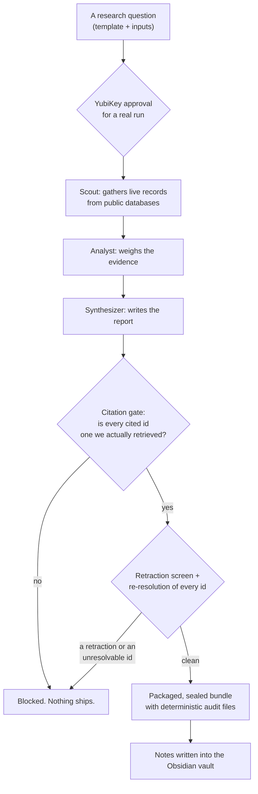

# How Trevor Robey, INC. works

> *Every claim, sourced. Every risk, named. In days, not weeks.*
>
> Citation-traced biomedical due diligence for biotech investors and pharma BD. Five days. Every citation
> grounded and retraction-screened. Audit trail included.

Trevor Robey, INC. is the wordmark of Trevor Robey Intelligence Network Citations LLC, a California limited
liability company. INC = Intelligence Network Citations.

This is the one plain-language story of the business: what it sells, how a report gets made, why its
citations can be trusted, and what is real today versus planned. It was written on 2026-10-23 from the
live system. The technical record is [`ARCHITECTURE.md`](ARCHITECTURE.md); what is in flight is on the
[continuity board](_continuity/CONTINUITY.md); where the business stands is [`STATUS.md`](STATUS.md).

---

## 1. The business in one paragraph

A one-person California LLC (CA SOS Entity No. B20260217250, approved 2026-06-18) that sells **research
reports in which every claim is traced to a public identifier**: a PubMed article (PMID), a
ClinicalTrials.gov trial (NCT), a ChEMBL compound, or a DOI. The buyers are people who make expensive bets
on drugs and trials and need to check the evidence quickly: biotech investors, pharma business
development and competitive-intelligence teams, research groups, patient advocacy groups, and medical
startup founders. The reports are **research artifacts**, not clinical decision support, and no patient
data (PHI) is ever used.

## 2. What is for sale

The canonical list, with prices, is [`OFFERINGS.md`](Trevor%20Robey%20Intelligence%20Network%20Citations/OFFERINGS.md).
In short:

- **Investor Pre-Mortem** (the lead product): a per-asset risk dossier covering trial design, comparable
  failures, sentiment and IP runway.
- **Failed Trial Archaeology**: a structured post-mortem of Phase 2/3 terminations for one mechanism.
- **Tactical reports**: Conference Synthesis Brief, Trial Design Benchmark Pack, Scoped Research Pack,
  Cross-Silo Connector Report, Plain-Language Patient Brief, Pharmacovigilance Pack.
- **The first data product**: the Trial Graveyard Feed on AWS Data Exchange (section 7).

Custom research on any topic is **not** for sale yet: those price tiers are on hold by the operator.

## 3. How a research run works



1. **A question goes in.** It is one of ten templates (drug discovery, pharmacovigilance, clinical-trial
   landscape, target validation, rare disease, general research, trial-design benchmark, plus three
   business templates), each with a few inputs such as an indication or a compound.
2. **The operator approves it.** A real run spends model capacity, so it needs a fresh YubiKey approval
   (a PIN and a physical touch, valid for one run and five minutes).
3. **Three Claude roles do the research.** The *scout* gathers records from public databases (PubMed,
   ClinicalTrials.gov, ChEMBL, Open Targets, Semantic Scholar and about 2,100 more tools), the *analyst*
   weighs them, the *synthesizer* writes the report. Claude is the only model in the engine.
4. **The citation gates check the report** (section 4). If it fails, nothing ships.
5. **The report is packaged.** Everything is sealed with a checksum per file, so any later change is
   detectable.
6. **The run lands in Obsidian** as linked notes, without anyone needing to open Obsidian.

A typical run takes 5–10 minutes of machine time.

## 4. Why the citations can be trusted

The gates are the product. A report has to pass all of them:

- **Grounding.** Every identifier cited in the report must be one the engine actually retrieved during
  that run. At least 75% must be grounded, or the report is blocked. If nothing was retrieved at all, it
  is blocked too, instead of shipping on model memory.
- **Retraction screen.** Every cited paper is checked against Crossref and PubMed. One retracted paper
  blocks the whole report.
- **Re-resolution.** At delivery, every PMID, NCT and DOI is looked up again at the registry that issued
  it. Any identifier that does not resolve blocks delivery. This proves each identifier points at a real
  record; it does not prove the source's conclusions are right.
- **The model is told never to invent an identifier**, and to write `[no verifiable citation found]`
  instead.

The exact wording the business may use about these checks is fixed in
[`SYSTEM-REALITY.md`](Trevor%20Robey%20Intelligence%20Network%20Citations/SYSTEM-REALITY.md).

## 5. What the customer receives

A sealed bundle (ZIP), containing:

- **The report** (`report.md`), an evidence appendix, data tables and a preview, all written by Claude
  and all gated.
- **A citation-integrity ledger** that grades the report A–D from its grounded ratio (F and BLOCKED on
  any retraction). Made by code, not by a model.
- **A graveyard memo**: earlier programs in the same indication that were terminated, withdrawn or
  suspended, each with the sponsor's own stated reason.
- **A search-coverage ledger**: every search and what it returned, with honest "zero results" kept
  apart from "source unreachable".
- **A reproducibility manifest** recording how each identifier re-resolved.
- For the trial-design benchmark, a **comparison matrix** (Markdown + CSV).

## 6. The machine room

Everything runs on one Mac. **Obsidian is the console**: its plugins start runs, receive results as
notes, draw diagrams, and search the vault.

```
Obsidian
├── Command Center (:8799)   starts research runs, receives results
├── Viz Studio     (:8800)   draws diagrams and charts into Visualizations/
├── vault bridge   (:8798)   the Copilot plugin's way into the notes
└── Copilot                  chat and an agent inside Obsidian

Claude (in Claude Code) ── one door: "openclaw-obsidian" ──> Command Center + Viz Studio
```

- **Claude has exactly one door** into Obsidian. Through it Claude can start and watch runs, read and
  search notes (read-only), and draw visuals, which land only in `Visualizations/`. It cannot create,
  edit or run anything else.
- **Copilot and Raycast keep their own doors.** Copilot chat runs on hosted `copilot-plus-flash`; its
  agent mode runs on an opencode backend.
- **Security is layered on top**: every network service on the Mac is HTTPS-only, real runs and
  privileged actions need a YubiKey touch, and CrowdStrike Falcon watches the machine. The security stack
  protects the business; it is not something the business sells.

## 7. The first product: Trial Graveyard Feed

A register of terminated, withdrawn and suspended clinical trials by therapeutic area, each row with the
sponsor's stated stop reason and a link to the trial. It is built by code from public registry data (no
model, no patient data). The staged 2026-10-21 refresh covers 12 areas and 7,373 rows; breast cancer is
capped at 2,000 of 2,034 trials and is not a complete census. The AWS seller account is cleared to publish
paid products, but **nothing is uploaded or listed yet**: the launch decisions (which areas, the price)
are the operator's and are deferred. Details:
[the feed's README](Trevor%20Robey%20Intelligence%20Network%20Citations/workspace/aws-marketplace-listing/trial-graveyard-feed/README.md).

## 8. Built versus not yet real

| Area | State on 2026-10-23 |
|---|---|
| Revenue | **$0.** No listings live, no deals. |
| Biomedical research engine | **Works.** Run #6 (2026-10-08) delivered with 45 of 45 citations verified. |
| Business research lane | Built and unit-tested; **never run live**. |
| Amendment-risk band in the graveyard memo | Paused: ClinicalTrials.gov refuses the history endpoint (HTTP 403 since 2026-10-08). |
| Research REST API, scheduled runs, usage metering | Code and tests exist; **not deployed**. |
| Trial Graveyard Feed | Refresh reviewed; **not uploaded**. |
| Entity compliance (EIN, LLC-12, franchise tax) | **Behind** — see `STATUS.md`. |
| Local Ollama model for Copilot | Ollama runs, but **no model is installed**. |

## 9. Glossary

| Term | Meaning |
|---|---|
| **PMID / NCT / ChEMBL / DOI** | Public identifiers for a PubMed article, a ClinicalTrials.gov trial, a ChEMBL compound, a published work |
| **Grounded** | A cited identifier that the engine actually retrieved during the run |
| **Re-resolution** | Looking each identifier up again at its issuing registry at delivery time |
| **Template** | One of the ten kinds of research run, each with its own inputs |
| **Scout / analyst / synthesizer** | The three Claude roles that gather, weigh and write |
| **Bundle** | The sealed ZIP a customer receives |
| **Engine** | The research software in `Trevor Robey Intelligence Network Citations/` |
| **Vault** | The operator's Obsidian notes (`My Digital Garden`) |
| **Bridge** | A small HTTPS server inside Obsidian that lets software talk to a plugin |
| **The door** | `openclaw-obsidian`, Claude's single, limited way into Obsidian |
| **YubiKey touch** | The physical approval required for real runs and privileged actions |
| **OpenClaw** | The open-source agent framework the engine is built on (not a brand the business owns) |
