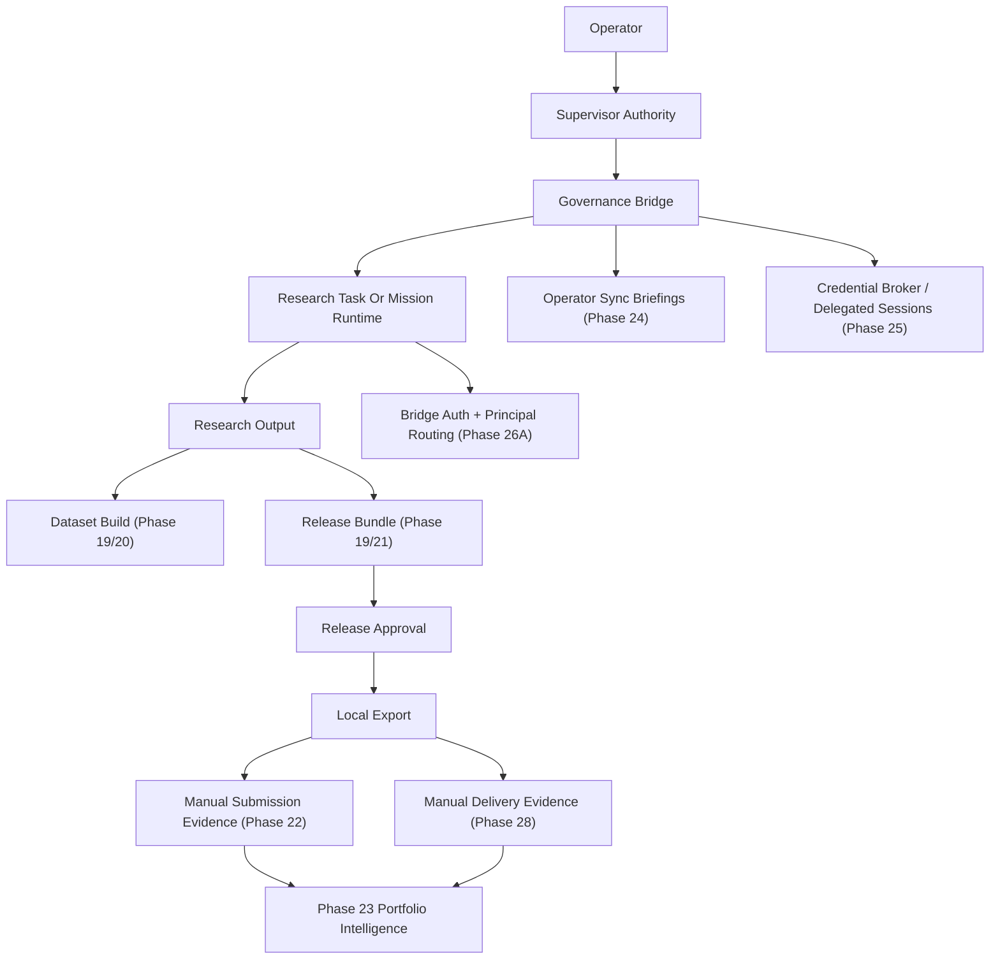

# Trevor Robey Inc Agents Dossier

This is the canonical repo-root handoff for humans and Claude.

It is intentionally synthesized rather than transcript-dumped. The goal is to explain what this project is, what is actually implemented, what is still pending, and how Claude should continue from the real current state of the codebase.

---

## What changed since this dossier was last fully refreshed (delta as of 2026-05-07)

1. **Legal entity formed.** Brand wordmark **"Trevor Robey, INC."** is now backed by **Trevor Robey Intelligence Network Citations LLC**, a California limited liability company filed at bizfileOnline 2026-05-06 (receipt B20260217250). CA SOS approval is pending the standard 2–3 business-day window. Customer-facing materials pair the wordmark with the disclosure: *"Trevor Robey, INC. is the wordmark of Trevor Robey Intelligence Network Citations LLC, a California limited liability company."* Filing record: [`../trevor-robey-inc/00-business-formation/llc/certificate-of-formation.md`](../trevor-robey-inc/00-business-formation/llc/certificate-of-formation.md). Compliance pattern explained in [`REVENUE_PLAYBOOK.md` §0a](REVENUE_PLAYBOOK.md).

2. **Repo topology — single monorepo.** This codebase is no longer a standalone GitHub repo. As of 2026-05-07 it lives as a top-level directory inside the monorepo, now **local-only** at `/Users/trevorrobey/TrevClaw-Obsidianodus` (the private GitHub remote was **deleted 2026-05-26**; **no git remotes** — durable backup is a `git bundle --all` at `~/TrevClaw-Obsidianodus.bundle`). The previous standalone remote `https://github.com/trevoralexanderrobey/trevor-robey-inc-agents` is the rollback anchor (tag `pre-monorepo-consolidation-2026-05-07` at SHA `8e782a0`); the repo is being archived. The three sister sub-trees (`Claude/`, `Copilot-Everything/`, `trevor-robey-inc/`) are now siblings of `trevor-robey-inc-agents/` inside the monorepo. Submodule `vendor/tooluniverse/` is pinned at SHA `3833b0e` (v1.1.10).

3. **AWS Data Exchange listing — staged, awaiting approvals.** Standards-compliant listing draft for the free Pharmacovigilance Sample Pack is complete in [`workspace/aws-marketplace-listing/pharmacovigilance-sample-pack/`](workspace/aws-marketplace-listing/pharmacovigilance-sample-pack/) (manifest: [`MANIFEST.md`](workspace/aws-marketplace-listing/pharmacovigilance-sample-pack/MANIFEST.md)). Pre-flight integrity checks pass. Two approvals gate go-live: (a) AWS Data Exchange Provider Qualification (Support case in flight, 7-business-day SLA), and (b) public seller profile verification (independent 2–3 business-day review). Target go-live: Week 3 (May 11–15). Scheduled play-by-play: [`../trevor-robey-inc/05-launch-plan/week-3-may11-may15/aws-listing-go-live.md`](../trevor-robey-inc/05-launch-plan/week-3-may11-may15/aws-listing-go-live.md). Free-tier publishes first; paid Investor Pre-Mortem and Failed Trial Archaeology dossiers list separately after the seller profile validates.

4. **HTTPS-only invariant — Miyo carve-out closed.** Miyo's plaintext :8742 is now wrapped by an in-monorepo TLS proxy at [`../Copilot-Everything/scripts/miyo-tls-proxy.mjs`](../Copilot-Everything/scripts/miyo-tls-proxy.mjs) listening on `https://127.0.0.1:8743`, owned by launchd unit `com.trevorrobey.miyo-tls-proxy`. All consumers now point at `:8743`. See root `CLAUDE.md` "HTTPS-only invariant" section.

5. **InfraNodus / TrevNodus fully removed.** No local clone, no webview handoff, no MCP server, no `graph-sync/` hydrator package. The biomedical workflow's post-run analysis is handled by the Medical Zettelkasten MCP under `Claude/Medical-Zettelkasten-MCP/`; visualization is on-demand via Obsidian's native Graph view.

For the unchanged technical baseline (Phase system, scripts, MCP servers, governance), continue below.

---

## Source Of Truth Order

When sources disagree, use them in this order:

1. Current repo code and git state.
2. Current repo docs and scripts.
3. The four session transcripts explicitly reviewed for this dossier.
4. External vault notes under `/Volumes/ExtraCurricular/My Digital Garden/OpenClaw Research Agents/` as historical context only.

Important implication:

- Older vault notes that say Phase 18+ was not implemented on `main` are historical snapshots, not current truth.
- `workspace/MEMORY.md` and `workspace/HEARTBEAT.md` are stale Phase 1 artifacts and should not be used as the current phase indicator.

## What This Project Is

Trevor Robey Inc Agents is the runtime engine behind **Trevor Robey, INC.** — citation-traced biomedical due diligence for biotech investors and pharma BD. Local-first, governed, manual-only external actions. Powered by OpenClaw (open-source agent framework).

> *Trevor Robey, INC. is the wordmark of **Trevor Robey Intelligence Network Citations LLC**, a California limited liability company (filed 2026-05-06). INC = Intelligence Network Citations.*

It runs six biomedical workflows that feed concrete commercial offerings: **Investor Pre-Mortem** (primary, $9,950–$19,950) and **Failed Trial Archaeology** (flanking, $14,950) drive premium revenue; tactical SKUs (Conference Synthesis Brief, Trial Design Benchmark Pack, Cross-Silo Connector Report, Plain-Language Patient Brief, Pharmacovigilance Pack) serve secondary demand. Every claim PMID / NCT / ChEMBL CID / DOI traced, with a refund-backed citation-audit SLA.

Originally framed as a "governed, local-first biomedical research and dataset packaging system." Same engine; sharper commercial framing as of 2026-04-30.

In plain English:

- It runs six prebuilt biomedical research workflows (`drug-discovery-full`, `pharmacovigilance-report`, `clinical-trial-landscape`, `target-validation-pack`, `rare-disease-brief`, `general-research-pack`) end-to-end via a single command.
- It pulls live evidence from ToolUniverse (~2,116 biomedical tools, Apache-2.0, Harvard MIMS / Zitnik Lab) plus eight project MCP servers (ChEMBL, ClinicalTrials.gov, PubMed, HuggingFace Hub, NPI Registry, ICD-10, Owkin pathology, Google Drive).
- It produces ZIP release bundles containing a multi-section research report (40 KB+ typical), a citation-index CSV in which every row carries a real identifier (PMID, NCT, ChEMBL CID, DOI), an executive summary, a provenance manifest, and structured metadata.
- It tracks evidence after export so the operator can prove what was shipped, where it went, and what happened next.
- It is designed to help the operator turn research work into monetizable outputs without crossing the repo's manual-only external-action boundary.

The project is not a fully autonomous publishing bot. It is a controlled preparation, packaging, evidence, and operator-assistance system aimed at regulated buyers (pharma R&D teams, biotech, life-science VC, biotech/pharma-focused quant funds, big-pharma + CRO data teams) who need defensible chain-of-custody for every artifact.

## Provenance

Trevor Robey Inc Agents is authored by Trevor Robey. It is a downstream consumer of two key upstream stacks; it claims authorship of neither.

- **OpenClaw — open-source agent framework (clean-room derivative).** OpenClaw is the open-source engine that powers Trevor Robey Inc Agents. It is not a brand owned by Trevor Robey Intelligence Network Citations LLC. Architectural and governance patterns are preserved as a clean-room derivative. The `openclaw-bridge/openclaw.json` flag `cleanRoomDerivative: true` is the canonical anchor. The `openclaw-bridge/` directory name is intentionally retained as upstream attribution. Trevor Robey Inc Agents is not affiliated with or endorsed by the consumer "Personal AI assistant" distributed at `openclaw.ai` (which is unrelated to this project).
- **ToolUniverse (Apache-2.0).** Vendored under `vendor/tooluniverse/` as a git submodule. Powers biomedical tool discovery and execution for all six workflow templates. Cite as: Gao et al., "ToolUniverse: A Universal Toolkit for Heterogeneous Scientific Tools," arXiv:2509.23426, 2025.

The full upstream attribution stack — including biomedical data sources (PubMed/NLM, ClinicalTrials.gov/NIH, ChEMBL/EBI, OpenTargets, DrugBank, CMS NPI, ICD-10/WHO, Owkin), runtime (Node.js, npm, Python via uv for the ToolUniverse subprocess only), and the project's no-clinical-use disclaimer — lives in [NOTICE.md](NOTICE.md).

The moat is operator-side: Trevor Robey Inc Agents enforces citation traceability as a quality gate (outputs without verifiable PMID/NCT/CID/DOI fail the gate, not pass with a warning), encodes hundreds of hours of pharmacovigilance / target-validation / trial-landscape methodology in the six prebuilt templates, and bakes the manual-only external-action boundary into the architecture as a feature for regulated buyers.

## Current Truth As Of March 23, 2026

Git state captured for this dossier:

- `main` is at merge commit `e2c9196`.
- The current checked-out branch is `codex/phase26-bridge-runtime-and-execution-router-consolidation`.
- The repo baseline was clean before this dossier file was added.

What is implemented:

- Phases 1-13: governance, safety, policy, runtime integrity, and identity groundwork.
- Phase 14: supervisor-gated research task execution.
- Phase 15: deterministic multi-agent topology and lane/comms model.
- Phase 16: MCP-based research ingestion.
- Phase 17: runtime hardening and resume orchestration.
- Phase 18: mission orchestration and agent spawning under bounded, deterministic rules.
- Phase 19: dataset foundation and release-pack packaging.
- Phase 20: dataset commercialization gates, provenance, quality, and license review.
- Phase 21: publisher adapter boundaries and release approval validation.
- Phase 22: post-export manual submission evidence ledgers.
- Phase 23: read-only portfolio intelligence and commercialization decision support.
- Phase 24: operator sync and briefing artifacts for Notion/newsletter mutation flows.
- Phase 25: credential broker and delegated session governance.
- Phase 26A: bridge auth, principal resolution, and route/lane separation prerequisite slice.
- Phase 27: governed Sider + Hatchify integration on a read-only/manual-only basis.
- Phase 28: direct-delivery packaging and post-export delivery evidence governance.

What is still pending:

- Full Phase 26 consolidation. The repo has the Phase 26A prerequisite slice, but not the full bridge runtime and execution-router consolidation described in the roadmap.

## What The System Actually Does

At a high level, the system turns approved research work into governed deliverables:

1. An operator initiates work.
2. Supervisor and governance approval gates decide whether the work can run.
3. Research tasks or missions produce durable local artifacts.
4. Those artifacts can be shaped into datasets or release bundles.
5. Releases can be approved and exported locally.
6. External publication or delivery still happens manually.
7. Submission and delivery evidence is recorded afterward.
8. Phase 23 then reads that evidence and produces decision-support reports.

## How The System Works



## Architecture Map

### Provider Stack (LLMs + tool surface)

| Provider | Role | Status | Notes |
| --- | --- | --- | --- |
| **Claude Code CLI** (`claude-sonnet-4-6`) | Primary LLM | Active | `claude -p` stdin pipe, authenticated via Claude Max Pro. Default for all production tiers. |
| **LM Studio** (local) | Fallback LLM | Active | `qwen2.5-coder-7b-instruct` on `localhost:1234`; `mistral-nemo-12b` documented as alt for stronger reasoning. |
| **Mock provider** | Test / CI | Active | Deterministic; required for offline `npm test`. |
| **Ollama** | Local LLM slot | Disabled | Configured but not enabled in `config/llm-providers.json`. |
| **ToolUniverse** (subprocess) | Biomedical tool surface | Active | ~2,116 tools, Apache-2.0, Harvard MIMS / Zitnik Lab; vendored at `vendor/tooluniverse/`; Phase 29 verified. |
| **Scholar Gateway (Semantic Scholar)** | First-class literature lane | Active | `SemanticScholar_search_papers` is wired into the role prefetch map for `scout`, `analyst`, `literature_reviewer`, and `competitive_intel_analyst` — runs alongside PubMed/EuropePMC for every literature-aware role, not as a fallback. Complementary in-process JS MCP at `openclaw-bridge/mcp/semantic-scholar-mcp.js`; full vendored toolset (7 tools: search_papers, get_paper, get_pdf_snippets, get_recommendations, get_author, search_authors, etc.) at `vendor/tooluniverse/src/tooluniverse/tools/SemanticScholar_*.py`. Smoke tests under `audit/evidence/mcp-live/semantic-scholar-*.json`. See `config/tool-prefetch-map.json` for current wiring. |
| **Project MCP servers** | Domain tool surface | Active | 8 servers under `openclaw-bridge/mcp/`: `chembl-mcp`, `clinicaltrials-gov-mcp`, `pubmed-mcp`, `huggingface-mcp` (metadata only), `npi-mcp`, `icd10-mcp`, `owkin-mcp`, `gdrive-mcp`. |

No HuggingFace model weights are downloaded or run. The `huggingface-mcp` server queries Hub metadata only. Qwen2.5-7B-Instruct and OpenBioLLM-Llama3-8B were named in earlier planning but are not part of this stack.

### Core Runtime

- `openclaw-bridge/core/`
  - research runtime, agent engine, governance bridge, role routing, mission orchestration, skill provider support
- `openclaw-bridge/state/`
  - persistent state, hydration, resume, open-loop handling
- `openclaw-bridge/bridge/`
  - bridge server, auth/principal resolution, MCP transport, jobs routing, worker/state-store TypeScript surfaces
- `openclaw-bridge/mcp/`
  - MCP services, research providers, governed mutation surfaces, stubs and active provider contracts

### Business And Governance Layers

- `workflows/`
  - governance automation, observability, supply-chain, recovery assurance, research ingestion, RLHF, experiment governance
- `analytics/`
  - monetization logic, explainability, Phase 23 portfolio intelligence, reporting
- `security/`
  - runtime policy, RBAC, mutation control, prompt sanitization, startup integrity checks

### Operator-Facing CLIs

- `scripts/`
  - task runners, mission runners, verification commands, export and evidence tooling, phase gates

### Durable Local State

- `workspace/`
  - missions, research input/output, datasets, releases, runtime state, operator briefs
- `audit/evidence/`
  - deterministic evidence bundles and phase-specific outputs

### Human Documentation

- `README.md`
- `ARCHITECTURAL_BLUEPRINT.md`
- `docs/phase23-portfolio-intelligence.md`
- `docs/phase24-operator-sync-and-briefing.md`
- `docs/phase25-credential-broker-and-session-governance.md`
- `docs/phase26-bridge-runtime-and-execution-routing.md`
- `future openclaw research agents phases to be implemented.`

## Commercial Scope

### Target buyers (2026-04-30)

| ICP | Buyer Titles | WTP Signal |
| --- | --- | --- |
| Biotech Equity Investors | Hedge fund PM, Biotech VC Partner, Family Office Research Director | $10K–$20K/seat entry; $50K–$100K+/yr enterprise |
| Pharma & Biotech R&D | Head of CI, VP BD/Licensing, SVP R&D Strategy, CMO | Mid-5 to low-6 fig per module / yr |
| Academic & Clinical Researchers | PI, Department Admin, Research Networks | $30K–$62.5K per grant minimum |
| Patient Advocacy Groups | Executive Director, Scientific Director | $5K–$50K project-based |

### Offering ladder (2026-04-30)

| Tier | SKU | Price | Format |
| --- | --- | --- | --- |
| **Primary** | Investor Pre-Mortem | $9,950 anchor / $14,950 standard / $19,950 custom (+ KOL primary) | Per-asset risk dossier; 5–10 business days, written Speed SLA |
| **Flanking primary** | Failed Trial Archaeology | $14,950 | Structured post-mortem of Phase 2/3 terminations |
| Tactical | Conference Synthesis Brief | $4,950 / conference | 500+ ASCO/ESMO/AACR abstracts; 24–48hr |
| Tactical | Trial Design Benchmark Pack | $4,950 | Comparative Phase 3 structure vs 10–20 comparable programs |
| Tactical | Cross-Silo Connector Report | $9,950 – $24,950 | Hidden mechanistic links across ChEMBL/PubMed/CT.gov |
| Tactical | Plain-Language Patient Brief | $2,500 | EU CTR 536/2014 PLS at 8th-grade literacy |
| Tactical (demoted) | Pharmacovigilance Pack | $2,500 – $4,950 | Existing marketplace tier; demoted from primary lead |

The prior Standard / Premium / Custom / Enterprise-ARR ladder is retired. Custom and enterprise-subscription delivery remains available for cloud-data-platform engagements, but the lead public ladder is the single-deliverable SKU table.

### Buyer-side guarantees baked into the architecture

- **Citation traceability is a gate, not a warning.** Outputs without verifiable PMID / NCT / ChEMBL CID / DOI fail the quality gate.
- **Manual-only external-action boundary.** Agents prepare, package, and produce evidence; they never autonomously publish, post, transact, log in, or browse. Human operator approval is required for every external step.
- **No PHI by design.** All queried sources are public biomedical databases (PubMed/NLM, ClinicalTrials.gov/NIH, ChEMBL/EBI, OpenTargets, DrugBank, CMS NPI, ICD-10/WHO, Owkin). The system does not host, transmit, or process Protected Health Information.
- **Defensible chain of custody.** Every export carries a deterministic provenance manifest plus cryptographically chained post-export evidence ledgers (Phase 22 submission evidence, Phase 28 delivery evidence). Buyers in regulated workflows get audit-ready artifacts.

### Disclaimer

Outputs are research artifacts, not validated for clinical decision support, pharmaceutical prescribing, regulatory submission, or any professional medical use. Buyers must independently verify, validate, and comply with applicable laws, regulations, and the upstream data-source licensing terms documented in [NOTICE.md](NOTICE.md).

## Phase Timeline

| Phase | What it added | Current status |
| --- | --- | --- |
| 1-13 | Governance, policy, safety, integrity, access-control groundwork | Implemented |
| 14-17 | Research runtime baseline, multi-agent topology, MCP ingestion, resume | Implemented |
| 18 | Mission orchestration and bounded spawning | Implemented |
| 19 | Dataset builds and release packaging | Implemented |
| 20 | Quality, license, provenance, commercialization gates | Implemented |
| 21 | Publisher adapter boundaries and release approval validation | Implemented |
| 22 | Manual submission evidence ledgers | Implemented |
| 23 | Read-only commercialization reporting and recommendations | Implemented |
| 24 | Operator sync/briefing artifacts for governed mutation flows | Implemented |
| 25 | Credential broker and delegated connector sessions | Implemented |
| 26A | Bridge auth/principal routing prerequisite slice | Implemented |
| 26 | Full bridge runtime and execution-router consolidation | Not yet complete |
| 27 | Governed Sider + Hatchify read-only/manual-only integration | Implemented |
| 28 | Direct-delivery evidence governance | Implemented |

## Session Chronology

These sessions are part of the practical source-of-truth for what recently happened in the repo.

| Session ID | Date | Main outcome |
| --- | --- | --- |
| `019d17e8-7678-7681-8ddf-c2e7eeb52fb9` | March 22, 2026 | Phase 23 implementation, verification, repo wiring, and GitGuardian fallback handling |
| `019d1851-d5b2-7752-9756-f9b0871a450b` | March 22, 2026 | Phase 24 completion and local verification on its own branch |
| `019d185f-6765-7ac1-adf9-d92f9b0e3f35` | March 22-23, 2026 | Non-technical framing, roadmap explanation, and Phase 25 to Phase 26 transition context |
| `019d1d65-022c-7f91-8f36-cfd349c1fc40` | March 23, 2026 | `gh-fix-ci` use, PR `#15` merge, and creation of the current Phase 26 branch |

### Session Notes

#### `019d17e8-7678-7681-8ddf-c2e7eeb52fb9`

- Anchored the repo restart from older session context.
- Landed Phase 23 portfolio intelligence as a read-only reporting layer.
- Tightened CI behavior around invalid GitGuardian auth so the repo can fall back to regex scanning when authenticated scanning is unavailable.

#### `019d1851-d5b2-7752-9756-f9b0871a450b`

- Established that Phase 23 had already landed on `main`.
- Completed Phase 24 locally with governed briefing artifacts for Notion/newsletter prepare flows.
- Verified `phase24:verify` and `build:verify` before moving on.

#### `019d185f-6765-7ac1-adf9-d92f9b0e3f35`

- Reframed the project for non-technical explanation.
- Captured the state after most of Phase 24 and during Phase 25 workflow work.
- Clarified the branch discipline and the move from Phase 25 to Phase 26.

#### `019d1d65-022c-7f91-8f36-cfd349c1fc40`

- Applied the `gh-fix-ci` skill to a real PR failure.
- Merged PR `#15` to `main`.
- Fast-forwarded local `main`.
- Created the current branch `codex/phase26-bridge-runtime-and-execution-router-consolidation`.

## Drift Matrix

This project has a real documentation-drift problem between the repo and the external vault. Use this matrix to resolve conflicts.

| Source | Status | How to treat it |
| --- | --- | --- |
| `README.md` | Still accurate, but summarize with code truth first | Current high-level repo contract |
| `ARCHITECTURAL_BLUEPRINT.md` | Mostly accurate | Good implemented-baseline summary, but still read code first |
| `future openclaw research agents phases to be implemented.` | Historical plus current roadmap | Accurate for the full-Phase-26 gap; also records what was implemented after the older roadmap lock |
| Vault note `OpenClaw Research Agents - 00 Project Truth.md` | Historical snapshot | Useful for earlier evidence anchors, but stale where it says Phase 18+ was not implemented on `main` |
| Vault note `OpenClaw Research Agents - 03 What Is Actually Working.md` | Historical snapshot | Good for earlier live-verification context, stale on later implemented phases |
| Vault note `OpenClaw Research Agents - 09 Next Steps (Phase 18+).md` | Stale as current-state guidance | Do not treat its "Phase 18+ not implemented" claim as current truth |
| `workspace/MEMORY.md` | Stale | Phase 1-era long-term fact stub, not current phase tracking |
| `workspace/HEARTBEAT.md` | Stale | Says current phase is 1; this is no longer true |
| Reference doc `References/Building OpenClaw Research Engine.md` | Vision document | Use for original intent and monetization vision, not for exact current implementation status |
| `Sider.ai Integration with OpenClaw.md` | Historical design context | Useful for the rationale behind the 26A/27 integration path, but not the final implementation record |

Most important drift callout:

- The vault's old "Phase 18+ not implemented on `main`" position is historical only.
- Current repo truth is later than that note and includes Phases 23, 24, 25, 26A, 27, and 28 on top of the earlier baseline.

## Operational Entry Points

These are the real operator entry points exposed by the repo today.

| Purpose | Command |
| --- | --- |
| Run a single research task | `node scripts/run-research-task.js --task "<description>" --type <task_type> --confirm` |
| Run a mission | `node scripts/run-research-task.js --mission-template <template_id> --task "<description>" --confirm` |
| Resume a mission | `node scripts/run-research-task.js --resume-mission <mission_id> --confirm` |
| Run a research-to-dataset mission | `node scripts/run-dataset-mission.js --task "<description>" --dataset-type <type> --confirm` |
| Generate an offer/release bundle | `node scripts/generate-offer.js --source <mission_id|dataset_id> --product-line <line> --tier <tier> --confirm` |
| Approve a release bundle | `node scripts/approve-release.js --offer-id <offer_id> --confirm` |
| Export a release bundle | `node scripts/export-release.js --offer-id <offer_id> --format zip|folder --confirm` |
| Record manual submission outcome | `node scripts/record-submission-outcome.js --offer-id <offer_id> --platform-target <target> --operator-id <id> --outcome-state <state> --idempotency-key <key> --confirm` |
| Record manual delivery outcome | `node scripts/record-delivery-outcome.js --offer-id <offer_id> --delivery-target <target> --operator-id <id> --outcome-state <state> --idempotency-key <key> --confirm` |
| Generate Phase 23 report artifacts | `node scripts/generate-phase23-report.js --confirm` |

Useful verification commands:

- `npm run phase23:verify`
- `npm run phase24:verify`
- `npm run phase25:verify`
- `npm run phase26:verify`
- `npm run monetization:verify`
- `npm run build:verify`

## Current Gaps And Next Work

The main unfinished system-level item is full Phase 26.

### What "Phase 26" still means

The repo already has Phase 26A, which added:

- bridge auth
- principal resolution
- route/lane separation
- MCP streamable HTTP groundwork

But the roadmap still says Phase 26 needs broader consolidation across:

- `openclaw-bridge/bridge/server.ts`
- `openclaw-bridge/bridge/worker.ts`
- `openclaw-bridge/bridge/state-store.ts`
- `openclaw-bridge/bridge/types.ts`
- `openclaw-bridge/src/core/execution-router.ts`

So the next real implementation target is not "invent another new business feature." It is finishing the underlying bridge/runtime/execution-router consolidation that Phase 26A intentionally stopped short of.

### Secondary caveats

- Older vault notes correctly captured that live-provider and live-MCP evidence was only partially verified at that time.
- Those notes are still useful as reliability caveats, but they are not the current roadmap blocker in the codebase.
- The current branch focus is full Phase 26 consolidation.

## Instructions For Claude

Claude should use this dossier as the starting handoff for this repo.

Rules:

1. Read this file first.
2. Then read the current repo docs and inspect the code before trusting older vault notes.
3. If this dossier conflicts with the external vault notes, prefer the repo and current git state.
4. Treat `workspace/MEMORY.md` and `workspace/HEARTBEAT.md` as stale unless separately refreshed.
5. Use `skill-creator` for any OpenClaw-specific skill work.
6. Default new OpenClaw skills to project-local scope, not global scope.
7. Only promote a skill to global if it is genuinely reusable outside this repo without OpenClaw-specific nouns, paths, phases, or contracts.

## Skill Policy

> Note: "OpenClaw" in skill names below refers to the open-source agent framework that this engine is built on, not a brand owned by Trevor Robey Intelligence Network Citations LLC. Skill IDs are technical identifiers and stay as-is.

Project-local skill location:

- `workspace/skills/<skill-id>/SKILL.md`

Important note:

- `workspace/skills/` is already configured as a workspace skill source in this repo, even though the directory does not exist yet.
- If Claude starts creating project-local skills, it should create the `workspace/skills/` directory first and then add each skill under its own folder.

Promotion rule for global skills:

- Keep it project-local if it references OpenClaw phases, bridge principals, release/evidence ledgers, repo-specific scripts, or hard-coded repo paths.
- Consider global promotion only if the skill still makes sense after removing OpenClaw names and can help unrelated repos.

## Project-Local Skill Backlog

| Skill ID | Classification | Purpose |
| --- | --- | --- |
| `openclaw-repo-orientation` | Project-local | Fast repo map, source-of-truth order, and doc/code drift guidance for future agents |
| `openclaw-phase-timeline` | Project-local | Understand implemented phases, pending Phase 26 work, and chronological development history |
| `openclaw-governance-boundaries` | Project-local | Summarize what is manual-only, what is operator-gated, and what must never be automated |
| `openclaw-monetization-ops` | Project-local | Explain research -> dataset -> offer -> approval -> export -> evidence workflows and commands |
| `openclaw-bridge-phase26` | Project-local | Focus future agents on the missing full-Phase-26 bridge/runtime/execution-router consolidation |
| `openclaw-evidence-ledgers` | Project-local | Explain Phase 22 and Phase 28 evidence stores, Phase 23 reporting inputs, and integrity rules |

## Global Candidates Later

These are not global yet. They are only candidates if later generalized and stripped of OpenClaw-specific assumptions.

| Skill ID | Classification | Why it might generalize later |
| --- | --- | --- |
| `phase-pr-workflow-guardrails` | Global-candidate | The branch/PR/CI discipline pattern could help other repos |
| `deterministic-operator-briefings` | Global-candidate | Governed prepare/review artifact generation could generalize |
| `manual-evidence-ledger-patterns` | Global-candidate | Append-only post-export evidence ledgers may be reusable in other governed systems |

## Prompt For Claude

Copy and paste this into Claude when handing off the repo:

```text
Read /Users/trevorrobey/trevor-robey-inc-agents/TREVOR_ROBEY_INC_AGENTS_DOSSIER.md first, then inspect the repo code and current docs before making assumptions.

Use the repo and current git state as the source of truth over any conflicting external vault notes. In particular, treat older notes that say Phase 18+ was not implemented on main as historical snapshots, not current truth.

This repo is a governed, local-first research/dataset/release system with manual-only external publication and delivery boundaries. Do not weaken those boundaries.

After you finish orienting yourself, use your skill-creator capability to create project-local skills for this repo under /Users/trevorrobey/trevor-robey-inc-agents/workspace/skills/<skill-id>/SKILL.md.

Default every new OpenClaw skill to project-local scope. Only promote a skill to global if it is clearly repo-agnostic, path-agnostic, and useful outside OpenClaw without phase-specific assumptions.

Start with this project-local skill backlog:
- openclaw-repo-orientation
- openclaw-phase-timeline
- openclaw-governance-boundaries
- openclaw-monetization-ops
- openclaw-bridge-phase26
- openclaw-evidence-ledgers

Before creating skills, confirm each one against the actual repo code, docs, and current branch state.
```

## Quick Reality Check

If you only remember five things about this repo, remember these:

1. It is not a fully autonomous external-action system; the manual-only boundary is deliberate.
2. The repo is later than the older vault notes suggest.
3. The current practical next implementation target is full Phase 26.
4. The monetization path depends on deterministic local artifacts plus post-export evidence, not blind automation.
5. Claude should create OpenClaw skills as project-local first.
