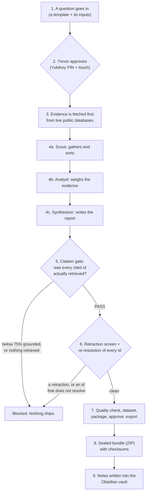
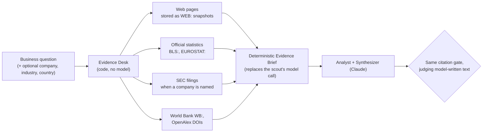

# 03 — How a research run works

> **Trevor: after reading this file, write `00-in-my-own-words.md`** — 5 to 10 sentences, in your own
> words, on how a run goes from a question to a sealed bundle. Claude reviews it before any marketing slide.

## The picture

[src: `HOW-IT-WORKS.md` §3; `ENGINE/docs/WORKFLOW_CATALOG.md` → "What every template shares"]

## Step by step

1. **A question goes in.** Each run uses one of **ten templates** — seven biomedical
   (`drug-discovery-full`, `pharmacovigilance-report`, `clinical-trial-landscape`, `target-validation-pack`,
   `rare-disease-brief`, `general-research-pack`, `trial-design-benchmark`) and three business
   (`business-research-pack`, `cost-reduction-analysis`, `market-landscape`). Each template asks for a few
   inputs, for example `indication` for the trial-design benchmark. [src: `ENGINE/docs/WORKFLOW_CATALOG.md`]
2. **Trevor approves it.** A real run spends model capacity, so it needs a freshly armed approval: a YubiKey
   PIN plus a physical touch, good for **one run within 300 seconds**. A practice run on the mock provider
   needs no approval and spends nothing. [src: `ENGINE/CLAUDE.md` → Quick Reference, operator authorization]
3. **Evidence is fetched before any model writes.** A prefetch layer pulls records for each role from Harvard's
   ToolUniverse (about 2,116 biomedical tools) and the engine's own connectors (PubMed, ClinicalTrials.gov,
   ChEMBL, Open Targets, Semantic Scholar and others). Every identifier fetched is remembered: this list is
   what the gate later checks against. [src: `ENGINE/CLAUDE.md` → "ToolUniverse Live Pre-Fetch", "Citation Integrity Layer"]
4. **Three Claude roles do the research.** The *scout* gathers, the *analyst* weighs, the *synthesizer*
   writes. All three run on Claude Opus (`claude-opus-4-8`); every other role runs on Claude Sonnet. Claude is
   the only model in the engine. Each role is told never to invent an identifier and to write
   `[no verifiable citation found]` instead. [src: `CLAUDE.md` → engine rules; `ENGINE/CLAUDE.md` → Citation gate]
5. **The citation gate checks the report.** Every identifier the report cites is compared with the list of
   identifiers actually retrieved. At least **75%** must match ("grounded"), or the report is blocked. If no
   evidence was retrieved at all, it is blocked too. Detail in `04`.
6. **Retraction screen and re-resolution.** Cited papers are checked against Crossref and PubMed for
   retractions (one retraction blocks the report), and every PMID, NCT and DOI is looked up again at its
   issuing registry (any that does not resolve blocks delivery).
7. **The rest of the pipeline.** Every template runs the same six steps: `research` → `quality_check` →
   `build_dataset` → `package` → `approve` → `export`. [src: `ENGINE/docs/WORKFLOW_CATALOG.md`]
8. **A sealed bundle.** The ZIP holds the report and the audit files (list in `04`), each with a checksum,
   so any later change is detectable. [src: `HOW-IT-WORKS.md` §3, §5]
9. **Notes land in Obsidian.** The engine writes the run's notes into the vault itself, under
   `OpenClaw/<template>/<date> <inputs>/`, only for a completed, gate-passing, non-mock run, and Obsidian does
   not need to be open. When Claude starts a run through its door, the Command Center plugin also runs its
   follow-up chain (chat notice, search index, linking, research memory). [src: `ENGINE/CLAUDE.md` → "Engine → Obsidian vault"; `CLAUDE.md` → Obsidian]

## What a real run looked like: run #6

| | |
|---|---|
| Template and input | `trial-design-benchmark`, indication "non-small cell lung cancer" |
| Run id | `workflow-6cc2f82cbced588b04c4d135` |
| Time | 2026-10-08, 05:59:36Z to 06:06:06Z (about 6.5 minutes of machine time) |
| Model use | 174,235 tokens across the three research subtasks (58,085 + 69,833 + 46,317) |
| Gate | PASS: 44 of 45 cited ids grounded (ratio 0.978, floor 0.75), 102 ids fetched |
| Retraction screen | checked: 14 DOIs and 10 PMIDs, 0 retracted |
| Re-resolution | **45 VERIFIED · 0 UNRESOLVED · 0 UNCHECKED** → delivery decision **DELIVER** |
| Benchmark | cohort of 20 of 675 eligible Phase 3 programs; 19 of 20 randomized |
| Graveyard memo | complete retrieval for the condition query: 1,412 of 1,412 stopped-trial records |
| Search coverage | 17 searches across 14 sources, 101 records, 1 honest zero |

[src: `ENGINE/workspace/workflows/workflow-6cc2f82cbced588b04c4d135/` *(on disk, not in git)*:
`workflow.json`, `citation-verification.json`, `reproducibility-manifest.md`, `design-benchmark.md`,
`graveyard-memo.md`, `search-coverage.md`]

It was the sixth real run through Claude's door that evening. Runs #1 to #5 each stopped, and each exposed a
real bug that was fixed before the next: for example, run #1 was blocked because a pattern mistook the
words "accessions" and "citation" for protein ids, and run #4 was blocked at packaging because an instruction
made the model write a word the shipment gate bans. [src: `ENGINE/CHANGELOG.md`, the 2026-10-08 entries]
The learning point: the gates block. They do not wave things through.

## How the business lane differs

Same pipeline, same gate, different evidence. [src: `ENGINE/CLAUDE.md` → "Business research lane"; `ENGINE/docs/business-research-lane.md`]

- **The scout's model call is replaced by code.** The Evidence Desk builds a deterministic Evidence Brief;
  the gate and the density audit judge only the text the models wrote.
- **Web pages are stored, not just linked.** A `WEB:` id is a snapshot of the exact text read. A page must
  mention at least half the question's content words or it is neither stored nor shown.
- **The best passages are quoted verbatim** as `WEB: <id> ¶<n>`, chosen by a passage-ranking step.
- **Official statistics** come from a reviewed series map: `BLS:` and `EUROSTAT:` today (no key needed);
  `CENSUS:` and `EIA:` are built but dormant until their free keys are registered. Keyless BLS allows about
  25 queries a day.
- **SEC filings** fire only when the inputs name a company or competitor.
- **Never run live.** The recommended first run is `cost-reduction-analysis` on "Where can a mid-size US 3PL
  warehouse cut labour and energy cost?" It needs Trevor's go and a fresh approval. [src: `STATUS.md`, queue item 9]
