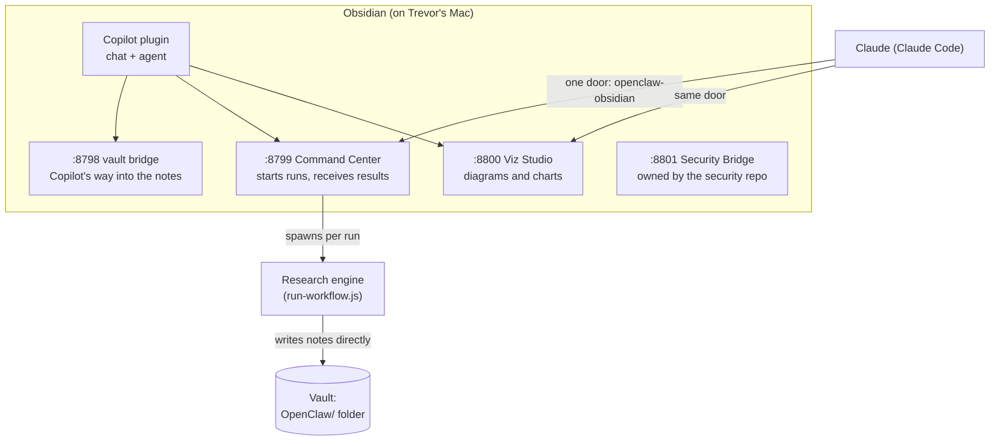

# 05 — The machine room

> **Learning deck only.** Client pitches get at most one line from this file ("runs on a single,
> hardware-key-approved research engine; every network service is HTTPS-only"). The port numbers, plugin
> names and security layers below are for Trevor's understanding, not for buyers.

## One Mac, one engine, Obsidian as the console

- **Everything runs on one Mac.** There is no cloud server and no persistent engine service: the engine is a
  program started once per run (`node scripts/run-workflow.js`). [src: `ARCHITECTURE.md` §2]
- **Obsidian is the console.** Its plugins start runs, receive results as notes, draw diagrams and search the
  vault. The vault is Trevor's notes folder, `My Digital Garden`. [src: `HOW-IT-WORKS.md` §6]
- **The code lives in one repository**, TRINC, at `/Users/myhome/TRINC`, pushed to a private GitHub repo.
  Every push needs Trevor's YubiKey touch, so pushes are always his. [src: `CLAUDE.md`, Hosting]

## The bridges inside Obsidian

A *bridge* is a small HTTPS server inside an Obsidian plugin that lets other software talk to that plugin. All
of them stop when Obsidian quits.

| Port | What it does | Owner |
|---|---|---|
| `:8798` | The vault bridge: reading and writing notes. Copilot uses it. | `obsidian-bridge-launcher` plugin |
| `:8799` | Command Center: starts research runs, reports status, receives results (32 tools) | `command-center` plugin |
| `:8800` | Viz Studio: diagrams, charts, canvases, explainer cards, stat tiles, mockups (12 tools); every render lands in `Visualizations/` | `trinc-viz-studio` plugin |
| `:8801` | Security Bridge: a security control plane with no vault access | the separate Security Everything repo |

[src: `ARCHITECTURE.md` §2, §4]

## Claude's one door

Claude reaches Obsidian through **exactly one door**, called `openclaw-obsidian` (27 tools). Through it Claude
can:

- start, watch, cancel and read research runs;
- search and read notes, **read-only**;
- draw visuals, which can land **only** in `Visualizations/`.

It **cannot** create or edit notes, run commands, or reach the `:8798` vault bridge. Six properties that
could steer a render elsewhere are stripped and refused. Sub-agents are barred from the door entirely.
[src: `ARCHITECTURE.md` §4, "Claude's door in detail"; §5]

Why one door: an earlier set of overlapping lanes included an ungated write path into the vault. It was
retired on 2026-10-23, so every Claude action in Obsidian goes through one narrow, tested entrance.
[src: `CLAUDE.md` → Obsidian section; `ops/reorg/2026-10-cleanup-manifest.md`, Phase 5]

**Copilot and Raycast keep their own doors.** Copilot chat runs on a hosted model (`copilot-plus-flash`); its
agent mode runs on an opencode backend. Raycast chat has a separate door to the vault tools.
[src: `HOW-IT-WORKS.md` §6; `ARCHITECTURE.md` §2]

## The engine's parts

- **Models:** Claude only. Scout, analyst and synthesizer on `claude-opus-4-8`; every other role on
  `claude-sonnet-4-6`; no fallback to any other model. [src: `CLAUDE.md` → engine rules]
- **Evidence tools:** Harvard ToolUniverse (about 2,116 tools) plus the engine's own adapters: ChEMBL,
  ClinicalTrials.gov, PubMed, Europe PMC, NIH RePORTER, NPI, ICD-10, HuggingFace (metadata only), arXiv,
  Semantic Scholar, Open Targets, SEC EDGAR, SearXNG, the business sources (web evidence, OpenAlex, SEC
  filings, World Bank, BLS, Eurostat, Census, EIA), the re-resolver and the retraction screens.
  [src: `ARCHITECTURE.md` §3.6]
- **Context-only lanes:** earlier research in the vault and the research memory are shown to the models as
  background, with identifiers withheld, and **never count as citations**. [src: same]
- **Third-party helpers**, each wrapped by an HTTPS proxy: Miyo (semantic search over the vault), Qdrant (its
  vector store), SearXNG (private metasearch), Ollama (running, **no model installed**). [src: `ARCHITECTURE.md` §2, §7]

## The security layers (they protect the business; they are not for sale)

- **HTTPS-only.** Every network listener in the repo is HTTPS and refuses to start without its certificate; no
  plaintext fallback exists.
- **YubiKey gates.** Real engine runs, privileged commands, the in-app browser and the gated tool servers all
  need a physical touch. The touch *is* the consent, and it is never removed.
- **Secrets** live in the Keychain or owner-only files, never in plugin settings.
- **CrowdStrike Falcon** watches the machine.
- **Posture:** research artifacts only; no PHI; no autonomous publishing, posting, logins or purchases.

[src: `ARCHITECTURE.md` §5; `HOW-IT-WORKS.md` §6]
