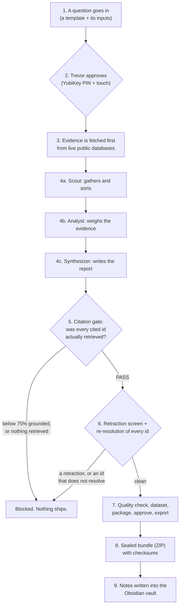
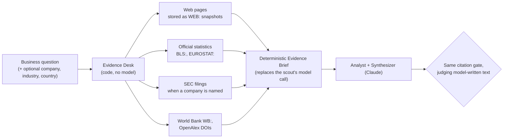
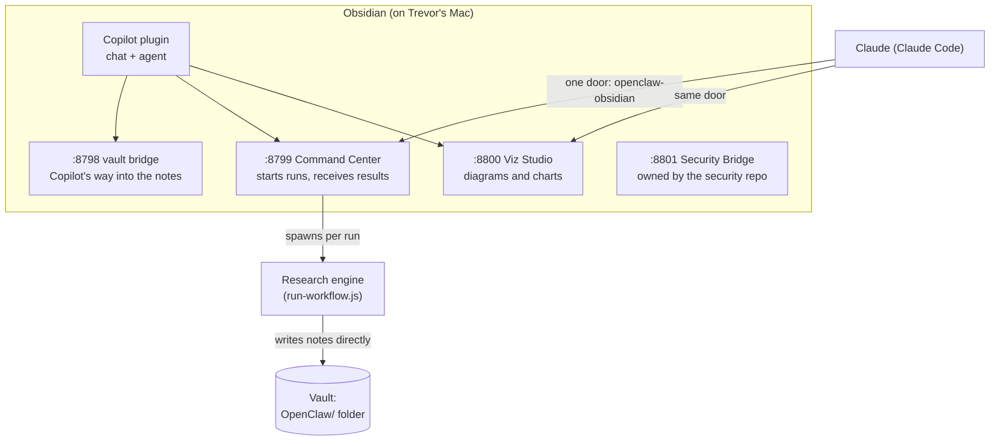

# TRINC learn-and-pitch pack (combined)

> Generated by `scripts/build-learn-and-pitch-pack.py` from the files in `docs/learn-and-pitch/`.
> Do not edit this file; edit the parts and rebuild. Start with part 00: it holds the rules.


---

<!-- part: 00-README-for-Claude.md -->

# TRINC learn-and-pitch pack: read this first

> **For Claude** (Claude.ai chat, Claude Desktop Chat, or any Claude session). These are the instructions for
> using this pack. Facts are as of **2026-10-23**. Written from the live TRINC repository at
> `/Users/myhome/TRINC`; every fact carries its source.

## Who you are working for

**Trevor Robey**, the operator and only person in **Trevor Robey Intelligence Network Citations LLC**, a
California LLC that trades under the wordmark **Trevor Robey, INC.** (INC = Intelligence Network Citations).
The business sells research reports in which every cited claim traces to a public identifier. Biomedical
due diligence is the flagship. Business research in any field runs on the same engine as a second lane.
[src: `HOW-IT-WORKS.md` §1; `ENGINE/OFFERINGS.md`]

## What to make, in this order

1. **The "Learn TRINC" deck — for Trevor only.** Every detail of how the business and its machine are set
   up, both lanes, what is built and what is still missing. It is a study deck, not a sales deck.
2. **The Feynman check (Trevor's part).** After reading `03-how-a-research-run-works.md`, Trevor writes
   `00-in-my-own-words.md`: 5 to 10 sentences on how a run works. **Review it for gaps and wrong ideas
   before you draft any marketing slide.** Point out what is missing kindly and specifically, citing the
   pack file that covers it.
3. **The biotech-investor pitch** (8 slides).
4. **The general, all-buyers pitch** (biomedical flagship, business research also available).
5. **Three animation storyboards**: a research run, the citation gate, the one door into Obsidian.

The detailed brief for each is `10-slide-and-animation-brief.md`.

## The pack

| File | What it holds |
|---|---|
| `01-what-TRINC-is.md` | Names, entity, buyers, the two lanes, what the business refuses to be |
| `02-offers-and-pricing.md` | The canonical prices, copied verbatim, plus what each SKU needs to be fulfilled |
| `03-how-a-research-run-works.md` | A run step by step, for both lanes, with diagrams |
| `04-trust-citation-integrity.md` | The citation gates, the approved wording for them, and their limits |
| `05-the-machine-room.md` | The Mac, Obsidian, the bridges, Claude's one door, the security layers |
| `06-first-product-trial-graveyard-feed.md` | The first data product (not listed yet) |
| `07-built-vs-not-built.md` | The honest state of every part, including what is missing |
| `08-glossary.md` | Every term and identifier type |
| `09-brand-kit.md` | Wordmark, disclosure line, colours, type, logo, voice, words never to use |
| `10-slide-and-animation-brief.md` | The decks and storyboards, slide by slide |

`TRINC-learn-and-pitch-pack.md` is all of the above in one file, for a single upload. It is generated: after
editing any part, rebuild it with `python3 /Users/myhome/TRINC/scripts/build-learn-and-pitch-pack.py`
(`--check` reports whether it is stale).

**How it reaches you.** Claude Desktop Chat reads this folder straight from disk
(`/Users/myhome/TRINC/docs/learn-and-pitch/`) through its Filesystem connector. For a claude.ai Project, Trevor
uploads the combined file (or the parts) as project knowledge and uses this file as the project instructions.

## The rules (hard, no exceptions)

1. **Only facts in this pack.** If a slide needs a fact the pack does not hold, write `[NEEDS SOURCE]` on the
   slide and ask Trevor. Never fill a gap from general knowledge, and never round a number up.
2. **Prices exactly as written in `02`.** Never compute a discount, a bundle, a total, an annual price or a
   new range. A price not in `02` does not exist.
3. **No invented proof.** No customers, testimonials, logos, case studies, quotes, market sizes or
   statistics that the pack does not source. Revenue is **$0** and there are **no customers yet**: say so
   on the learning deck; never imply customers in a pitch.
4. **Never write** "zero hallucinations", "no hallucinations", "hallucination-free", "100% accurate",
   "guaranteed correct" or "AI that never lies". Use the approved wording in `04`.
5. **Always carry these three lines** where a pitch describes what is delivered:
   - "Research artifacts only, not clinical decision support."
   - "No patient data (PHI) is used."
   - For business research: "Research, not legal, medical, tax or investment advice."
6. **Keep the re-resolution claim inside its bounds** (`04`): it proves an identifier points at a real
   record, not that the source's conclusions are right.
7. **Show what is not built as not built** (`07`). Mark anything uncertain `[UNVERIFIED]`.
8. **Business research is priced but not yet bookable.** Booking opens after the first live business run
   passes the citation gate; none has run. Every slide that shows those tiers says so.
9. **The Trial Graveyard Feed is not for sale yet.** It is not listed. Never offer it in a pitch.
10. **Company voice vs founder voice** (`09`). Pitches speak as the company.
11. **No private data.** Use only the public entity facts in `01`. No home address, phone, bank details,
    tax numbers, account ids, passwords, or anything from the formation paperwork beyond the entity name,
    number and approval date.
12. **Internal sections stay internal.** Anything in `07` marked INTERNAL, and the security details in
    `05`, belong on the learning deck only, never on a client slide.

## How sources are written

Each fact ends with `[src: <path>]`. Paths are relative to the repository root `/Users/myhome/TRINC`.
`ENGINE/` is short for the business folder `Trevor Robey Intelligence Network Citations/`. A source marked
*(on disk, not in git)* exists on Trevor's Mac but is not committed (run folders are kept out of git).

If two sources disagree, `ENGINE/OFFERINGS.md` wins on prices and offers, `ENGINE/SYSTEM-REALITY.md` wins on
what may be claimed about the citation checks, and `07-built-vs-not-built.md` wins on what is real.


---

<!-- part: 01-what-TRINC-is.md -->

# 01 — What TRINC is

## The names

| Name | What it is |
|---|---|
| **Trevor Robey, INC.** | The brand wordmark. "INC" stands for **Intelligence Network Citations**; it is a backronym, not a corporate suffix. [src: `ENGINE/01-brand-system/brand-identity-2026-07-29.md` §2] |
| **Trevor Robey Intelligence Network Citations LLC** | The legal entity: a California limited liability company, **CA SOS Entity No. B20260217250**, filed 2026-05-06, **approved 2026-06-18**. [src: `ENGINE/SYSTEM-REALITY.md` §1] |
| **TRINC** | Short for Trevor Robey Intelligence Network Citations. Since 2026-10-23 it is also the name of the code repository and the whole stack. [src: `CLAUDE.md`, top note] |
| **OpenClaw** | The open-source agent framework the engine is built on. Not a brand the business owns, and unrelated to the consumer "openclaw.ai" assistant. [src: `ENGINE/OFFERINGS.md` → Engine credit] |

**The disclosure line**, used wherever the wordmark appears in customer-facing material:

> Trevor Robey, INC. is the wordmark of Trevor Robey Intelligence Network Citations LLC, a California limited
> liability company.

[src: `HOW-IT-WORKS.md`, header]

Why the disclosure exists: California law bars "Inc." inside an LLC's name and restricts it in fictitious
business names, so the legal name spells the words out and the disclosure makes the entity type explicit.
[src: `CLAUDE.md` → TRINC product summary, compliance note]

Website: https://trevorobeyinc.com · Email: trevor@trevorobeyinc.com [src: `ENGINE/CLAUDE.md` → Marketing and Brand Infrastructure]

## The lines

- **Tagline:** *Every claim, sourced. Every risk, named. In days, not weeks.*
- **Elevator:** *Citation-traced biomedical due diligence for biotech investors and pharma BD. Five days.
  Every citation grounded and retraction-screened. Audit trail included.*

[src: `ENGINE/OFFERINGS.md`, lines 3–5]

## The business in one sentence

> Trevor Robey, INC. sells citation-traced biomedical due diligence to people making high-stakes bets on
> someone else's science — biotech investors and pharma business development — and its entire
> differentiator is that a claim without a verifiable identifier fails a gate rather than passing with a
> warning.

[src: `ENGINE/01-brand-system/brand-identity-2026-07-29.md` §1]

## One engine, two lanes

The business used to be biomedical only. Since 2026-10-21 the same engine has a second lane for business
research in any field. It is a **module inside the one engine**, not a second engine: both lanes share the
same pipeline and the same citation gate, and a template opts into the business lane with
`research_profile: business`. [src: `ENGINE/CLAUDE.md` → "Business research lane"; `ENGINE/docs/business-research-lane.md`]

| | Biomedical lane (the flagship) | Business lane (also available) |
|---|---|---|
| Questions | Drugs, trials, targets, safety signals, rare disease | Any field: cost cutting, market landscapes, a single agreed business question |
| Evidence it cites | PubMed (PMID), ClinicalTrials.gov (NCT), ChEMBL, DOIs, and other biomedical ids | Stored web-page snapshots (`WEB:`), SEC filings (`SEC:`), World Bank (`WB:`), BLS and Eurostat statistics, DOIs |
| Templates | 7 | 3 |
| State | Works; the latest proof run delivered 45 of 45 citations verified (run #6, 2026-10-08) | Built and unit-tested; **never run live** |
| Prices | The canonical ladder | Five tiers, approved 2026-10-23, **booking after the first live business run** |

[src: `ENGINE/docs/WORKFLOW_CATALOG.md`; `ENGINE/OFFERINGS.md`; `HOW-IT-WORKS.md` §8]

How to frame it (operator direction, 2026-10-23): biomedical research stays the focus and the flagship; the
business lane widens the same method to every other buyer. In brand copy, biomedical leads and business
research is "also available". [src: `ENGINE/product-strategy/tier-ladder-DRAFT-2026-10-20.md`, prerequisites; operator answers recorded in `ops/reorg/2026-10-cleanup-manifest.md`, Phase 7]

## Who buys

Five biomedical buyer segments are named in the canon:

1. **Biotech Equity Investors**: hedge fund PM, biotech VC partner, family office research director.
2. **Pharma & Biotech R&D**: head of competitive intelligence, VP BD/licensing, SVP R&D strategy, CMO.
3. **Academic & Clinical Researchers**: PIs, department admins, research networks.
4. **Patient Advocacy Groups**: executive and scientific directors.
5. **Medical Startup Founders** (added 2026-07-30): pre-seed to Series A founders in biotech, medtech and
   diagnostics.

[src: `ENGINE/OFFERINGS.md` → ICPs]

The business lane's buyer, in the operator's words: "any buyer [who] needs any research done in any field
… for cost cutting, or whatever their reason for needing a report may be."
[src: `ENGINE/product-strategy/tier-ladder-DRAFT-2026-10-20.md`, opening quote]

> ⚠ **Do not put the ICP table's market statistics on a slide.** The pain and willingness-to-pay cells in
> `ENGINE/OFFERINGS.md` (for example "58.3% Phase 2→3 failure" or "60%+ hallucination in domain LLMs") came
> from a 2026-04-30 Demand-Validation Report whose source files are **not on this machine**.
> `ENGINE/OFFERINGS.md` → Source says so itself. Treat them as `[UNVERIFIED]` until re-sourced. The one sourced
> cell is the founder segment's SBIR/STTR figure (NIH Guide Notice NOT-OD-26-075).

## What the business refuses to be

- **Not clinical decision support.** Research artifacts only.
- **Not a PHI processor.** No patient data is hosted, sent or processed.
- **Not a publishing bot.** Every external action (publishing, posting, uploads, logins, sales) is manual.

[src: `ENGINE/OFFERINGS.md` → Posture]

## Where it stands (2026-10-23)

- **Revenue: $0.** Nothing listed, no deals on record. [src: `STATUS.md`]
- **One person, one Mac.** [src: `HOW-IT-WORKS.md` §1, §6]
- **Proof of method:** run #6, a Trial Design Benchmark for non-small cell lung cancer, delivered on
  2026-10-08 with 45 of 45 citations re-resolved VERIFIED (detail in `04`).


---

<!-- part: 02-offers-and-pricing.md -->

# 02 — Offers and pricing

> **Prices are copied verbatim from `ENGINE/OFFERINGS.md`, the only canonical list.** Never compute,
> discount, bundle, total or annualise them. If `ENGINE/OFFERINGS.md` changes, this file is out of date.

## A. The biomedical ladder (the flagship)

[src: `ENGINE/OFFERINGS.md` → "Offering Ladder"]

| Tier | SKU | Description | ICP | Price |
|---|---|---|---|---|
| **Primary** | **Investor Pre-Mortem** | Per-asset risk dossier — trial design + comparable failures + KOL sentiment + IP runway. Every claim PMID/NCT/ChEMBL-traced. 5–10 business days, written Speed SLA. | Biotech hedge funds, biotech-specialist VC, pharma BD/licensing | **$9,950 / $14,950 / $19,950 (+ KOL primary)** |
| **Flanking primary** | **Failed Trial Archaeology** | Structured post-mortem of Phase 2/3 terminations in a single mechanism. NCT-indexed failure pattern matrix. | Pharma R&D CI, biotech VC diligence | **$14,950** |
| Tactical | Conference Synthesis Brief | 500+ ASCO/ESMO/AACR abstracts synthesized in 24–48 hours. | Pharma R&D, investors, BD | **$4,950 / conference** |
| Tactical | Trial Design Benchmark Pack | Comparative Phase 3 structure analysis vs **up to 20** comparable programs — allocation, masking, intervention model, arms, enrollment, primary endpoints, sponsor class. Cohort is reported as **N of M eligible** under a stated selection rule; where an indication has fewer than 20 eligible programs the pack covers the **entire** eligible population and says so. | Biotech R&D, pharma CI | **$4,950** |
| Tactical | **Scoped Research Pack** | One agreed **biomedical** research question, scoped in writing before the run and answered through the **full citation-integrity gate** — same guarantee as every other gated SKU. Bounded to a **single question at fixed depth**; the bound is what makes a flat price honest. If the evidence does not exist, the bundle ships the **search-coverage ledger documenting exactly that**, never a padded report. | Medical-startup founders (SBIR/STTR Phase I), investors with a question outside the standard SKUs | **$4,950** |
| Tactical | Cross-Silo Connector Report | Hidden mechanistic links across ChEMBL/PubMed/CT.gov as repurposing opportunities. | Pharma R&D, biotech partnerships | **$9,950 – $24,950** |
| Tactical | Plain-Language Patient Brief | Regulatory-compliant PLS at 8th-grade health-literacy level (EU CTR 536/2014). | Patient Advocacy Groups, trial sponsors | **$2,500** |
| Tactical (demoted) | Pharmacovigilance Pack | Safety-signal + AEMS/FAERS analysis with a graded citation-integrity ledger. Existing marketplace listings preserved. | Mid-market pharma safety teams | $2,500 – $4,950 |

## B. Business research, any field (also available — booking gated)

[src: `ENGINE/OFFERINGS.md` → "Business research (any field)"]

> Prices approved by the operator on 2026-10-23. **Booking opens after the first live business-lane run
> passes the citation gate**; as of 2026-10-23 none has run. Biomedical due diligence stays the flagship.

| Tier | Scope | Turnaround | Price |
|---|---|---|---|
| **Quick Brief** | One question, a short answer memo with every source listed | 3 business days | **$1,500** |
| **Standard Report** | One agreed question at fixed depth: full report + source ledger (the Scoped Research Pack, widened to any field) | 5 business days | **$4,950** |
| **Deep-Dive Report** | Up to three related questions: options compared, cost-avoidance or cost-cutting analysis, risks named | 10 business days | **$9,950** |
| **Research Retainer** | An ongoing research desk: up to two Standard-depth reports a month, plus quick questions | monthly | **$7,500 / month** |
| **Enterprise Program** | Multi-month programs, private data rooms, or reports built on the client's own data | scoped in writing | **custom quote** |

- Every tier: the question and depth are agreed in writing before the run. If the evidence does not exist,
  the report says so and shows what was searched.
- Sold by direct invoice, or as an AWS private offer for buyers who pay through their AWS bill.
- Research, not advice: never legal, medical, tax or investment advice.
- The guarantee's scope for business identifiers is in `04`.

## C. What each SKU needs to be delivered (read before pitching any of them)

A price on the ladder is not proof the engine can produce the SKU. This table is what the sources say.

| SKU | Engine template | A completed run on disk? | Status for a pitch |
|---|---|---|---|
| Trial Design Benchmark Pack | `trial-design-benchmark` | **Yes, 3 runs passed the gate; run #6 is the proof run** | ✅ Proven. Lead with it. |
| Failed Trial Archaeology | `clinical-trial-landscape` | Yes, 3 completed runs (2026-06/07); the latest (2026-07-16) stores a PASS verdict, the two earlier ones predate that record format | ✅ Path verified [src: `ENGINE/01-brand-system/founder-lane-2026-07-29.md` §1] |
| Scoped Research Pack | `general-research-pack` | No completed run stored | ⚠ Built, not shown live |
| Pharmacovigilance Pack | `pharmacovigilance-report` | No completed run stored | ⚠ Built, not shown live |
| Investor Pre-Mortem | **no single template is named for it** | — | ⚠ `[UNVERIFIED]` fulfilment path. Confirm with Trevor before a pitch promises its Speed SLA. |
| Cross-Silo Connector Report | no template named | — | ⚠ `[UNVERIFIED]` fulfilment path |
| Conference Synthesis Brief | none | — | ❌ No ingestion code exists [src: `ENGINE/01-brand-system/founder-lane-2026-07-29.md` §1] |
| Plain-Language Patient Brief | none | — | ❌ No code implements the plain-language transform [src: same] |
| Business tiers (all five) | `business-research-pack`, `cost-reduction-analysis`, `market-landscape` | **No live run ever** | ⏳ Priced; booking after the first live run |

[src for the run column: `ENGINE/workspace/workflows/` *(on disk, not in git)*, six stored runs, all
`completed`: three `trial-design-benchmark`, three `clinical-trial-landscape`. Templates: `ENGINE/docs/WORKFLOW_CATALOG.md`]

**Rule for the pitches:** show the ladder as written ("show the core ladder", operator, 2026-10-23), but the
*proof* slides use only what has run. Do not describe how a ❌ or ⚠ SKU is produced.

## D. The commitments, in short

- **Zero-Fabrication Guarantee.** Findings are never fabricated to fit what the research is looking for.
  Every cited identifier is grounded in evidence actually retrieved for the report, or it is flagged
  `[UNVERIFIED]` and never presented as fact; if the evidence isn't there, the report says so.
- **Citation-Audit SLA**, refund-backed, on every deliverable.
- **Speed SLA:** 5–10 business days for Investor Pre-Mortem (written guarantee).
- **Scope:** both commitments cover what the engine enforces on an engine-generated deliverable, and only
  sections cited to identifier types the engine recognises. Anything else (patent evidence is the live
  example) sits outside them and must say so on its face.

[src: `ENGINE/OFFERINGS.md` → Brand Commitments]

## E. Not on the ladder (do not offer)

- **The Trial Graveyard Feed** (data product): not listed; its prices are on hold (`06`).
- **A founder patent/IP brief:** no price, pending California counsel review.
  [src: `ENGINE/OFFERINGS.md` → ICPs, founder note]
- **The amendment-risk band:** paused since 2026-10-08 (`04`).


---

<!-- part: 03-how-a-research-run-works.md -->

# 03 — How a research run works

> **Trevor: after reading this file, write `00-in-my-own-words.md`** — 5 to 10 sentences, in your own
> words, on how a run goes from a question to a sealed bundle. Claude reviews it before any marketing slide.

## The picture



[src: `HOW-IT-WORKS.md` §3; `ENGINE/docs/WORKFLOW_CATALOG.md` → "What every template shares"]

## Step by step

1. **A question goes in.** Each run uses one of **ten templates** — seven biomedical
   (`drug-discovery-full`, `pharmacovigilance-report`, `clinical-trial-landscape`, `target-validation-pack`,
   `rare-disease-brief`, `general-research-pack`, `trial-design-benchmark`) and three business
   (`business-research-pack`, `cost-reduction-analysis`, `market-landscape`). Each template asks for a few
   inputs, for example `indication` for the trial-design benchmark. [src: `ENGINE/docs/WORKFLOW_CATALOG.md`]
2. **Trevor approves it.** A real run spends model capacity, so it needs a freshly armed approval: a YubiKey
   PIN plus a physical touch, good for **one run within 300 seconds**. A practice run on the mock provider
   needs no approval and spends nothing. [src: `ENGINE/CLAUDE.md` → Quick Reference, operator authorization]
3. **Evidence is fetched before any model writes.** A prefetch layer pulls records for each role from Harvard's
   ToolUniverse (about 2,116 biomedical tools, which is how PubMed, ClinicalTrials.gov and Semantic Scholar
   are searched) and the engine's own connectors (Open Targets, whose records carry ChEMBL ids, the
   ClinicalTrials.gov stop-reason fetcher, and others). Every identifier fetched is remembered: this list is
   what the gate later checks against. [src: `ENGINE/CLAUDE.md` → "ToolUniverse Live Pre-Fetch", "Citation Integrity Layer"]
4. **Three Claude roles do the research.** The *scout* gathers, the *analyst* weighs, the *synthesizer*
   writes. All three run on Claude Opus (`claude-opus-4-8`); every other role runs on Claude Sonnet. Claude is
   the only model in the engine. Each role is told never to invent an identifier and to write
   `[no verifiable citation found]` instead. [src: `CLAUDE.md` → engine rules; `ENGINE/CLAUDE.md` → Citation gate]
5. **The citation gate checks the report.** Every identifier the report cites is compared with the list of
   identifiers actually retrieved. At least **75%** must match ("grounded"), or the report is blocked. If no
   evidence was retrieved at all, it is blocked too. Detail in `04`.
6. **Retraction screen and re-resolution.** Cited papers are checked against Crossref and PubMed for
   retractions (one retraction blocks the report), and every PMID, NCT and DOI is looked up again at its
   issuing registry (any that does not resolve blocks delivery).
7. **The rest of the pipeline.** Every template runs the same six steps: `research` → `quality_check` →
   `build_dataset` → `package` → `approve` → `export`. [src: `ENGINE/docs/WORKFLOW_CATALOG.md`]
8. **A sealed bundle.** The ZIP holds the report and the audit files (list in `04`), each with a checksum,
   so any later change is detectable. [src: `HOW-IT-WORKS.md` §3, §5]
9. **Notes land in Obsidian.** The engine writes the run's notes into the vault itself, under
   `OpenClaw/<template>/<date> <inputs>/`, only for a completed, gate-passing, non-mock run, and Obsidian does
   not need to be open. When Claude starts a run through its door, the Command Center plugin also runs its
   follow-up chain (chat notice, search index, linking, research memory). [src: `ENGINE/CLAUDE.md` → "Engine → Obsidian vault"; `CLAUDE.md` → Obsidian]

## What a real run looked like: run #6

| | |
|---|---|
| Template and input | `trial-design-benchmark`, indication "non-small cell lung cancer" |
| Run id | `workflow-6cc2f82cbced588b04c4d135` |
| Time | 2026-10-08, 05:59:36Z to 06:06:06Z (about 6.5 minutes of machine time) |
| Model use | 174,235 tokens across the three research subtasks (58,085 + 69,833 + 46,317) |
| Gate | PASS: 44 of 45 cited ids grounded (ratio 0.978, floor 0.75), 102 ids fetched |
| Retraction screen | checked: 14 DOIs and 10 PMIDs, 0 retracted |
| Re-resolution | **45 VERIFIED · 0 UNRESOLVED · 0 UNCHECKED** → delivery decision **DELIVER** |
| Benchmark | cohort of 20 of 675 eligible Phase 3 programs; 19 of 20 randomized |
| Graveyard memo | complete retrieval for the condition query: 1,412 of 1,412 stopped-trial records |
| Search coverage | 17 searches across 14 sources, 101 records, 1 honest zero |

[src: `ENGINE/workspace/workflows/workflow-6cc2f82cbced588b04c4d135/` *(on disk, not in git)*:
`workflow.json`, `citation-verification.json`, `reproducibility-manifest.md`, `design-benchmark.md`,
`graveyard-memo.md`, `search-coverage.md`]

It was the sixth real run through Claude's door that evening. Runs #1 to #5 each stopped, and each exposed a
real bug that was fixed before the next: for example, run #1 was blocked because a pattern mistook the
words "accessions" and "citation" for protein ids, and run #4 was blocked at packaging because an instruction
made the model write a word the shipment gate bans. [src: `ENGINE/CHANGELOG.md`, the 2026-10-08 entries]
The learning point: the gates block. They do not wave things through.

## How the business lane differs

Same pipeline, same gate, different evidence. [src: `ENGINE/CLAUDE.md` → "Business research lane"; `ENGINE/docs/business-research-lane.md`]



- **The scout's model call is replaced by code.** The Evidence Desk builds a deterministic Evidence Brief;
  the gate and the density audit judge only the text the models wrote.
- **Web pages are stored, not just linked.** A `WEB:` id is a snapshot of the exact text read. A page must
  mention at least half the question's content words or it is neither stored nor shown.
- **The best passages are quoted verbatim** as `WEB: <id> ¶<n>`, chosen by a passage-ranking step.
- **Official statistics** come from a reviewed series map: `BLS:` and `EUROSTAT:` today (no key needed);
  `CENSUS:` and `EIA:` are built but dormant until their free keys are registered. Keyless BLS allows about
  25 queries a day.
- **SEC filings** fire only when the inputs name a company or competitor.
- **Never run live.** The recommended first run is `cost-reduction-analysis` on "Where can a mid-size US 3PL
  warehouse cut labour and energy cost?" It needs Trevor's go and a fresh approval. [src: `STATUS.md`, queue item 9]


---

<!-- part: 04-trust-citation-integrity.md -->

# 04 — Trust: citation integrity

> The gates are the product. A report reaches a customer only if it passes all of them.
> [src: `HOW-IT-WORKS.md` §4]

## The checks, in the order they run

| # | Check | What it does | What fails it |
|---|---|---|---|
| 1 | **Zero-fabrication instruction** | Every role is told never to invent a PMID, NCT or DOI and to write `[no verifiable citation found]` instead. | — (an instruction, not a check) |
| 2 | **Grounding gate** | Every identifier cited in the assembled report is compared with the identifiers actually retrieved during the run. A match is "grounded"; a miss is "ungrounded" and is marked `[UNVERIFIED]` inline. | Below **75%** grounded → `UNVERIFIED`; nothing retrieved at all → `INSUFFICIENT_EVIDENCE`; no citations → `NO_CITATIONS`. Only `PASS` ships. The 75% floor is read fail-closed: a missing setting means the strict value. |
| 3 | **Retraction screen** | Cited DOIs are checked against Crossref, cited PMIDs against PubMed, and every DOI is also mapped to its PMID and checked in PubMed. | Any retracted paper → hard stop (`RETRACTED`). |
| 4 | **Re-resolution at delivery** | Every cited PMID, NCT and DOI is looked up again at the registry that issued it (NCBI, ClinicalTrials.gov, Crossref) and stamped VERIFIED, UNRESOLVED or UNCHECKED in the reproducibility manifest. | Any UNRESOLVED id → `BLOCK`. `DELIVER` needs 100% VERIFIED; otherwise `DELIVER_WITH_FLAGS`. |
| 5 | **Shipment licence check** | Content from sources the business holds no redistribution licence for is refused at packaging. | A banned source name or id anywhere in the bundle. |

[src: `ENGINE/CLAUDE.md` → "Citation Integrity Layer" and "Instructions must not contradict the shipment gate";
`ENGINE/SYSTEM-REALITY.md` → "GAP CLOSED"]

## What the customer can check for themselves

Every bundle seals these files beside the report, and **code, not a model, writes them**:

- **`citation-integrity.md`**: a grade from the grounded ratio (A/B/C/D; F and BLOCKED on any retraction;
  N/A if nothing is cited).
- **`graveyard-memo.md`**: earlier terminated, withdrawn or suspended programs in the indication, each with
  the sponsor's own stated stop reason — or "(none stated by sponsor)", never an invented one — and a link to
  the trial.
- **`search-coverage.md`**: every search the run made and what each returned. A search that honestly found
  nothing is listed apart from a source that could not be reached, because "zero results" and "failed" are
  different facts. A zero-evidence run still ships this ledger rather than a padded report.
- **`reproducibility-manifest.md`**: how every cited PMID, NCT and DOI re-resolved, with HTTP status, URL and
  time.
- For the trial-design benchmark: **`design-benchmark.md` / `.csv`**, a comparison matrix rendered straight
  from registry records.
- **`checksums.txt`**: one checksum per file, so any later change is detectable.

[src: `ENGINE/OFFERINGS.md` → "Bundle deliverables"; `ENGINE/CLAUDE.md` → "Integrity-driven deliverables"; `HOW-IT-WORKS.md` §5]

## The exhibit: run #6 (2026-10-08)

| Check | Result |
|---|---|
| Grounding | **PASS**, 44 of 45 cited ids grounded (0.978 against a 0.75 floor); 102 ids retrieved |
| Retraction screen | checked; 14 DOIs and 10 PMIDs; **0 retracted** |
| Re-resolution | **45 VERIFIED · 0 UNRESOLVED · 0 UNCHECKED** of 45 → **DELIVER** |
| Graveyard memo | complete retrieval: **1,412 of 1,412** stopped-trial records for the condition query "non-small cell lung cancer" (complete for that term; another name for the disease returns a different set) |
| Benchmark | **20 of 675** eligible Phase 3 programs, every row linked to its ClinicalTrials.gov record |
| Search coverage | 17 searches, 14 sources, 101 records, 1 honest zero (stated, not hidden) |

[src: `ENGINE/workspace/workflows/workflow-6cc2f82cbced588b04c4d135/` *(on disk, not in git)*]

Note the one ungrounded citation, DOI `10.3389/fonc.2024.1422160`. The gate passed the report and marked
that citation `[UNVERIFIED]` in the annotated report instead of hiding it. Re-resolution then found the DOI
is real (VERIFIED at Crossref). **"Ungrounded" does not mean "fake"**: it means the model cited something
the run did not retrieve, so the run itself cannot vouch for it. The two checks answer different questions
(*did we read it?* versus *does it exist?*), which is why both run. [src: run #6 `citation-verification.json`
→ `ungrounded_list`; `reproducibility-manifest.md`; `report-annotated.md` *(on disk, not in git)*]

## Approved wording (use these, word for word or very close)

- "Every citation grounded and retraction-screened. Audit trail included." [src: `ENGINE/OFFERINGS.md`, elevator]
- "Every cited identifier is grounded in real evidence actually retrieved for the report, or it is flagged
  `[UNVERIFIED]` and never presented as fact." [src: `ENGINE/OFFERINGS.md` → Brand Commitments]
- "Every cited PMID, NCT and DOI is re-resolved against its issuing public registry at delivery."
- "A claim without a verifiable identifier fails a gate rather than passing with a warning."
  [src: `ENGINE/01-brand-system/brand-identity-2026-07-29.md` §1]

## The bounds (every pitch keeps these)

1. **Re-resolution proves an identifier points at a real record. It does not prove the source's
   conclusions are correct.**
2. An identifier with no definite answer is reported **UNCHECKED**, never VERIFIED.
3. The gates cover only sections cited to identifier types the engine recognises. **Patent evidence is
   outside the gate today** (a patent number matches none of the recognised types), so a patent section
   would say "patent evidence, outside the citation gate" on its face.
4. The deterministic memos (graveyard, search coverage) are grounded by construction but are **not counted**
   in the grade.
5. A hand-assembled deliverable that never ran through the engine claims none of this.

[src: `ENGINE/SYSTEM-REALITY.md` → "GAP CLOSED"; `ENGINE/OFFERINGS.md` → Brand Commitments, scope]

> ⚠ **Do not soften re-resolution to "grounding only".** That was true before 2026-07-10 and is now a false
> understatement. [src: `ENGINE/SYSTEM-REALITY.md`, copy-sweep warning]

## The business lane's identifiers and their limits

| Id | What it is | What re-resolution proves |
|---|---|---|
| `WEB: <12 hex>` | A stored snapshot of the exact page text the model saw | **Exactly what was read, from which URL and when.** Not that the page is correct or still online. |
| `SEC: <cik>/<accession>` | An SEC EDGAR filing | The filing exists |
| `WB: <indicator>` | A World Bank indicator | The indicator exists |
| `BLS:` / `EUROSTAT:` (`CENSUS:` / `EIA:` dormant) | Official statistics series | **The series, not the value.** Agencies revise values; the report shows the value as published on the retrieval date. |
| DOI (via OpenAlex) | A published work | The DOI resolves |

Pages behind a paywall or that need JavaScript to show their text are skipped.
[src: `ENGINE/OFFERINGS.md` → "Business research (any field)", guarantee scope; `ENGINE/docs/business-research-lane.md` → identifiers and "Limits to keep in the copy"]

## What is paused

**The amendment-risk band** (LOW/MODERATE/HIGH, from how often a trial's protocol was amended) is not
produced: ClinicalTrials.gov has refused the change-history requests it needs with HTTP 403 since
2026-10-08, and the engine does not try to get around the refusal. The memo says "Not available for this
run". **Do not sell the band.** [src: `ENGINE/OFFERINGS.md` → Bundle deliverables; `ENGINE/CLAUDE.md`]


---

<!-- part: 05-the-machine-room.md -->

# 05 — The machine room

> **Learning deck only.** Client pitches get at most one line from this file ("runs on a single,
> hardware-key-approved research engine; every network service is HTTPS-only"). The port numbers, plugin
> names and security layers below are for Trevor's understanding, not for buyers.

## One Mac, one engine, Obsidian as the console

- **Everything runs on one Mac.** There is no cloud server and no persistent engine service: the engine is a
  program started once per run (`node scripts/run-workflow.js`). [src: `ARCHITECTURE.md` §2]
- **Obsidian is the console.** Its plugins start runs, receive results as notes, draw diagrams and search the
  vault. The vault is Trevor's notes folder, `My Digital Garden`. [src: `HOW-IT-WORKS.md` §6]
- **The code lives in one repository**, TRINC, at `/Users/myhome/TRINC`, pushed to a private GitHub repo.
  Every push needs Trevor's YubiKey touch, so pushes are always his. [src: `CLAUDE.md`, Hosting]

## The bridges inside Obsidian

A *bridge* is a small HTTPS server inside an Obsidian plugin that lets other software talk to that plugin. All
of them stop when Obsidian quits.



| Port | What it does | Owner |
|---|---|---|
| `:8798` | The vault bridge: reading and writing notes. Copilot uses it. | `obsidian-bridge-launcher` plugin |
| `:8799` | Command Center: starts research runs, reports status, receives results (32 tools) | `command-center` plugin |
| `:8800` | Viz Studio: diagrams, charts, canvases, explainer cards, stat tiles, mockups (12 tools); every render lands in `Visualizations/` | `trinc-viz-studio` plugin |
| `:8801` | Security Bridge: a security control plane with no vault access | the separate Security Everything repo |

[src: `ARCHITECTURE.md` §2, §4]

## Claude's one door

Claude reaches Obsidian through **exactly one door**, called `openclaw-obsidian` (27 tools). Through it Claude
can:

- start, watch, cancel and read research runs;
- search and read notes, **read-only**;
- draw visuals, which can land **only** in `Visualizations/`.

It **cannot** create or edit notes, run commands, or reach the `:8798` vault bridge. Six properties that
could steer a render elsewhere are stripped and refused. Sub-agents are barred from the door entirely.
[src: `ARCHITECTURE.md` §4, "Claude's door in detail"; §5]

Why one door: an earlier set of overlapping lanes included an ungated write path into the vault. It was
retired on 2026-10-23, so every Claude action in Obsidian goes through one narrow, tested entrance.
[src: `CLAUDE.md` → Obsidian section; `ops/reorg/2026-10-cleanup-manifest.md`, Phase 5]

**Copilot and Raycast keep their own doors.** Copilot chat runs on a hosted model (`copilot-plus-flash`); its
agent mode runs on an opencode backend. Raycast chat has a separate door to the vault tools.
[src: `HOW-IT-WORKS.md` §6; `ARCHITECTURE.md` §2]

## The engine's parts

- **Models:** Claude only. Scout, analyst and synthesizer on `claude-opus-4-8`; every other role on
  `claude-sonnet-4-6`; no fallback to any other model. [src: `CLAUDE.md` → engine rules]
- **Evidence tools:** Harvard ToolUniverse (about 2,116 tools, which is also how PubMed and
  ClinicalTrials.gov are searched) plus the engine's own adapters: Europe PMC, NIH RePORTER, arXiv,
  Semantic Scholar, Open Targets, SEC EDGAR, SearXNG, the business sources (web evidence, OpenAlex, SEC
  filings, World Bank, BLS, Eurostat, Census, EIA), ClinicalTrials.gov stop reasons, the re-resolver and
  the retraction screens.
  [src: `ARCHITECTURE.md` §3.6]
- **Context-only lanes:** earlier research in the vault and the research memory are shown to the models as
  background, with identifiers withheld, and **never count as citations**. [src: same]
- **Third-party helpers**, each wrapped by an HTTPS proxy: Miyo (semantic search over the vault), Qdrant (its
  vector store), SearXNG (private metasearch), Ollama (running, **no model installed**). [src: `ARCHITECTURE.md` §2, §7]

## The security layers (they protect the business; they are not for sale)

- **HTTPS-only.** Every network listener in the repo is HTTPS and refuses to start without its certificate; no
  plaintext fallback exists.
- **YubiKey gates.** Real engine runs, privileged commands, the in-app browser and the gated tool servers all
  need a physical touch. The touch *is* the consent, and it is never removed.
- **Secrets** live in the Keychain or owner-only files, never in plugin settings.
- **CrowdStrike Falcon** watches the machine.
- **Posture:** research artifacts only; no PHI; no autonomous publishing, posting, logins or purchases.

[src: `ARCHITECTURE.md` §5; `HOW-IT-WORKS.md` §6]


---

<!-- part: 06-first-product-trial-graveyard-feed.md -->

# 06 — The first product: Trial Graveyard Feed

> **Not for sale yet.** Nothing is uploaded to AWS and nothing is listed. Its prices are on hold. It belongs on
> the learning deck; **never offer it in a pitch.** [src: `ENGINE/workspace/aws-marketplace-listing/trial-graveyard-feed/README.md`; `STATUS.md`]

## What it is

A register of **terminated, withdrawn and suspended clinical trials**, one data set per therapeutic area. Each
row carries the sponsor's own stated stop reason, quoted as written (or "(none stated by sponsor)" — a reason
is never inferred), and a link to `https://clinicaltrials.gov/study/<NCT>`.

It is built **by code from public registry data**: no language model, no patient data, and no data from
sources the business holds no licence to redistribute. It is a data product for AWS Data Exchange, not a
report. [src: feed `README.md`, opening]

## The staged refresh (2026-10-21, reviewed, 0 problems)

| Area | Paid rows | Census |
|---|---|---|
| Alzheimer disease | 435 | complete |
| amyotrophic lateral sclerosis | 116 | complete |
| breast cancer | 2,000 of 2,034 | **partial** (a 2,000-record safety cap) |
| glioblastoma | 389 | complete |
| idiopathic pulmonary fibrosis | 78 | complete |
| multiple sclerosis | 393 | complete |
| non-small cell lung cancer | 1,417 | complete |
| nonalcoholic steatohepatitis | 154 | complete |
| pancreatic cancer | 745 | complete |
| Parkinson disease | 415 | complete |
| prostate cancer | 1,051 | complete |
| sickle cell disease | 180 | complete |
| **Total** | **7,373 rows, 6,937 distinct trials** | 11 of 12 complete |

About **89.8%** of rows (6,623) carry a sponsor-stated reason. [src: feed `README.md` → Coverage]

## The honest caveats (each one must survive into any listing copy)

- **Breast cancer is not a complete census.** Never call it "all" or "complete".
- **The protocol-churn columns are empty** on every row, because ClinicalTrials.gov refuses the
  change-history endpoint (HTTP 403 since 2026-10-08). The amendment-risk band is UNKNOWN throughout.
- **326 trials appear in two or more areas.** `nct_id` is unique within an area, not across areas.
- **Rows change between pulls** (glioblastoma gained 5 trials and lost 6 between July and October). Never
  promise reproducible month-over-month diffs.

[src: feed `README.md`]

## Free and paid

| | Free Sample | Paid tiers |
|---|---|---|
| Rows | first 5 per area | every stopped trial the registry returns for the area's condition query, stated as N of M |
| Schema | identical | identical |
| Refresh | one-time | monthly revisions |

[src: feed `README.md` → Free / paid split]

## What is left before it can be listed (Trevor's decisions)

Which areas launch first (and whether breast cancer is in version 1), promoting the refresh into the
shipped `data/` folder, the price, and the AWS console steps. All were **deferred by Trevor on 2026-10-21**
until the business-engine work is set up. [src: `STATUS.md`, queue item 3]

Trevor set draft feed prices on 2026-10-20 (Free Sample, Essentials, Professional, Enterprise) and put them
back **on hold** on 2026-10-21. They must not appear on any slide. [src: `ENGINE/product-strategy/tier-ladder-DRAFT-2026-10-20.md`, Section A]


---

<!-- part: 07-built-vs-not-built.md -->

# 07 — Built versus not yet real

> The honest state of every part on **2026-10-23**. When this file and any other disagree about what is
> real, this file wins (and the disagreement should be reported to Trevor).

## The parts

| Area | State | Source |
|---|---|---|
| Revenue | **$0.** No listings live, no deals, no customers. | `STATUS.md` |
| Legal entity | **Exists and approved** (CA No. B20260217250, 2026-06-18) | `ENGINE/SYSTEM-REALITY.md` §1 |
| Biomedical engine | **Works.** Run #6 (2026-10-08) delivered 45 of 45 citations re-resolved VERIFIED. | `HOW-IT-WORKS.md` §8 |
| Citation gates (grounding, retraction screen, re-resolution) | **Built, wired, proven live** | `ENGINE/SYSTEM-REALITY.md` → "GAP CLOSED" |
| Trial Design Benchmark Pack | **Proven:** three gate-passing runs on disk | `ENGINE/workspace/workflows/` *(on disk)* |
| Failed Trial Archaeology | **Path verified** (`clinical-trial-landscape`, completed runs on disk) | `ENGINE/01-brand-system/founder-lane-2026-07-29.md` §1 |
| Scoped Research Pack, Pharmacovigilance Pack | **Templates built**; no completed run stored | `ENGINE/docs/WORKFLOW_CATALOG.md` |
| Investor Pre-Mortem, Cross-Silo Connector Report | **Priced; fulfilment path not documented** `[UNVERIFIED]` | `02` §C |
| Conference Synthesis Brief, Plain-Language Patient Brief | **Priced; no code** to produce them | `ENGINE/01-brand-system/founder-lane-2026-07-29.md` §1 |
| Business research lane | **Built and unit-tested; never run live.** Evidence Desk built. Census and EIA sources dormant until free keys are registered. | `STATUS.md`; `ENGINE/CLAUDE.md` |
| Business research tiers | **Priced (2026-10-23); booking after the first live run** | `ENGINE/OFFERINGS.md` |
| Web search for the business lane | SearXNG's general web results are unusable (only Bing answers, often for one word of the query); the lane uses the `science` category until a Brave Search API is added (deferred) | `ENGINE/CLAUDE.md` → Business research lane |
| Amendment-risk band | **Paused** (ClinicalTrials.gov HTTP 403 since 2026-10-08) | `ENGINE/OFFERINGS.md` |
| Patent evidence | **Outside the citation gate**; no patent SKU is priced | `ENGINE/01-brand-system/brand-identity-2026-07-29.md` §6 |
| Trial Graveyard Feed | **Refresh reviewed; not uploaded, not listed**; prices on hold | `06` |
| Research REST API, scheduled runs, usage metering | **Code and tests exist; not deployed** | `HOW-IT-WORKS.md` §8 |
| Obsidian pipeline (engine writes the vault, plugin enriches) | **Works headless** | `CLAUDE.md` → Obsidian |
| Claude's one door | **Live** (27 tools), first real runs through it 2026-10-08 | `ARCHITECTURE.md` §4 |
| Local Ollama model for Copilot | **Ollama runs, no model installed** | `ARCHITECTURE.md` §7 |
| Visuals in a run | **None automatic**; Viz Studio draws only on request | `ARCHITECTURE.md` §3.7 |
| CI | **None runs**; the local gates are the pipeline | `ENGINE/CLAUDE.md` → Tech Stack |

## INTERNAL — Trevor's open queue (learning deck only, never on a client slide)

| Item | Why it matters | Source |
|---|---|---|
| **Google Workspace payment failed**; Workspace suspends **2026-11-02** | It carries business mail and the AWS root email | `STATUS.md`, queue 1 |
| **Compliance is behind**: EIN not applied for; LLC-12 (due 2026-09-16) and the $800 FTB 3522 (due 2026-08-15) not filed | A suspended entity cannot sell | `STATUS.md`, queue 2 |
| AWS listing decisions deferred | The feed cannot list until they are made | `STATUS.md`, queue 3 |
| First live business-lane run | Business tiers stay closed until it passes | `STATUS.md`, queue 9 |
| Confirm how Investor Pre-Mortem is fulfilled | It is the lead SKU and carries a written Speed SLA | this pack, `02` §C |
| Re-source the ICP market statistics | They cannot go on slides until their sources are found | this pack, `01` |

## What "fully realised" would look like (the missing pieces, from the sources)

This is the gap list the learning deck should walk through, in the operator's framing of "the research
business engine sitting right next to the biomedical engine":

1. One live, gate-passing business-lane run (opens the five business tiers).
2. Census and EIA keys registered (switches on two dormant statistics sources).
3. A working general web search for the business lane (the Brave Search API, deferred).
4. A supported source for protocol history (brings back the amendment-risk band).
5. A patent identifier in the citation grammar plus a runtime patent source, shipped together (lets IP work
   be sold under the guarantee).
6. Fulfilment code for the Conference Synthesis Brief and the Plain-Language Patient Brief.
7. A documented, tested fulfilment path for Investor Pre-Mortem and Cross-Silo Connector Report.
8. The Trial Graveyard Feed listed on AWS.
9. The entity brought current (EIN, LLC-12, franchise tax) before any paid product goes public.

[src: items 1–3 `ENGINE/CLAUDE.md` → Business research lane, `STATUS.md`; item 4 `ENGINE/OFFERINGS.md`; item 5
`ENGINE/01-brand-system/brand-identity-2026-07-29.md` §6; item 6 `ENGINE/01-brand-system/founder-lane-2026-07-29.md` §1;
item 7 this pack `02` §C; items 8–9 `STATUS.md`]


---

<!-- part: 08-glossary.md -->

# 08 — Glossary

## Identifiers the engine can cite

| Id | Stands for | Where it points |
|---|---|---|
| **PMID** | PubMed ID | An article record in PubMed (NCBI) |
| **NCT** | ClinicalTrials.gov number, e.g. `NCT07388524` | A registered clinical trial |
| **DOI** | Digital Object Identifier | A published work (journal article, dataset) |
| **ChEMBL id** | ChEMBL compound or target id | EMBL-EBI's database of bioactive molecules |
| **PubChem CID** | PubChem compound id | NCBI's chemistry database |
| **UniProt accession** | Protein id | The UniProt protein database |
| **`WEB: <12 hex>`** | A stored web-page snapshot (business lane) | The exact text read, from one URL, at one time |
| **`SEC: <cik>/<accession>`** | An SEC EDGAR filing (business lane) | A US public-company filing |
| **`WB: <indicator>`** | A World Bank indicator (business lane) | A development statistics series |
| **`BLS:` / `EUROSTAT:`** | US Bureau of Labor Statistics / EU statistics office series (business lane) | An official statistics series |
| **`CENSUS:` / `EIA:`** | US Census / US Energy Information Administration (business lane, dormant) | Built, switched off until free keys are registered |

The biomedical citations a slide may show are **PMID, PubChem CID, NCT, UniProt, ChEMBL and DOI** (plus the
business-lane ids above). The engine also recognises one further drug database's ids, but only so the
shipment gate can **refuse** them: the business holds no licence to redistribute that content, and any bundle
carrying it is blocked. That database is deliberately not named in this pack; never name or cite it.
[src: `ENGINE/OFFERINGS.md` → Brand Commitments, scope; `ENGINE/CLAUDE.md` → "Instructions must not contradict the shipment gate"]

## The checks and their verdicts

| Term | Meaning |
|---|---|
| **Grounded** | A cited identifier the engine actually retrieved during the run |
| **Ungrounded** | A cited identifier the run did not retrieve; marked `[UNVERIFIED]` inline. It may still be real. |
| **Grounded ratio** | Grounded ÷ cited. The floor is 0.75. |
| **PASS / UNVERIFIED / INSUFFICIENT_EVIDENCE / NO_CITATIONS** | The gate's verdicts. Only PASS ships. |
| **Retraction screen** | Checking every cited paper against Crossref and PubMed for retraction |
| **Re-resolution** | Looking each PMID, NCT and DOI up again at its issuing registry at delivery |
| **VERIFIED / UNRESOLVED / UNCHECKED** | Re-resolution results. Any UNRESOLVED blocks delivery. |
| **DELIVER / DELIVER_WITH_FLAGS / BLOCK** | The delivery decision. DELIVER needs 100% VERIFIED. |
| **Honest zero** | A search that ran and truly found nothing, recorded as such rather than hidden |
| **Census** | Retrieving every record a registry holds for a query, stated as N of M |
| **Amendment-risk band** | LOW/MODERATE/HIGH from protocol amendment counts; paused since 2026-10-08 |

## The engine

| Term | Meaning |
|---|---|
| **Engine** | The research software in `Trevor Robey Intelligence Network Citations/` |
| **Template** | One of the ten kinds of research run, each with its own inputs |
| **Lane / research profile** | Biomedical (default) or business (`research_profile: business`): same engine, same gate |
| **Scout / analyst / synthesizer** | The three Claude roles that gather, weigh and write |
| **Evidence Desk** | The business lane's code that gathers and condenses evidence, replacing the scout's model call |
| **Prefetch** | Pulling live records before a model writes, so the gate has something to check against |
| **ToolUniverse** | Harvard's set of about 2,116 biomedical tools, used by the engine |
| **Bundle** | The sealed ZIP a customer receives, with a checksum per file |
| **Mock provider** | A practice mode that spends nothing and needs no approval |
| **Run #6** | The 2026-10-08 trial-design benchmark run used as the proof of method |

## The machine

| Term | Meaning |
|---|---|
| **Vault** | Trevor's Obsidian notes (`My Digital Garden`) |
| **Bridge** | A small HTTPS server inside an Obsidian plugin |
| **Command Center** | The plugin and bridge (`:8799`) that start runs and receive results |
| **Viz Studio** | The plugin and bridge (`:8800`) that draw diagrams into `Visualizations/` |
| **The door** | `openclaw-obsidian`, Claude's single, limited way into Obsidian |
| **Copilot** | The chat and agent plugin inside Obsidian |
| **YubiKey touch** | The physical approval required for real runs and privileged actions |
| **OpenClaw** | The open-source agent framework the engine is built on |

## The business

| Term | Meaning |
|---|---|
| **Trevor Robey, INC.** | The wordmark (INC = Intelligence Network Citations) |
| **TRINC** | Trevor Robey Intelligence Network Citations; also the repository's name |
| **ICP** | Ideal customer profile: a named buyer segment |
| **SKU** | A priced product on the ladder |
| **Ladder** | The priced list in `ENGINE/OFFERINGS.md` |
| **Speed SLA / Citation-Audit SLA** | The written turnaround promise / the refund-backed citation promise |
| **AWS private offer** | A custom-priced AWS Marketplace offer to one buyer, paid through their AWS bill |
| **AWS Data Exchange (ADX)** | AWS's marketplace for data products; where the feed will be listed |
| **PHI** | Protected health information (patient data); never used |


---

<!-- part: 09-brand-kit.md -->

# 09 — Brand kit

## Words

| Element | Use exactly |
|---|---|
| Wordmark | **Trevor Robey, INC.** |
| Expansion | INC = Intelligence Network Citations |
| Disclosure (on any customer-facing piece with the wordmark) | *Trevor Robey, INC. is the wordmark of Trevor Robey Intelligence Network Citations LLC, a California limited liability company.* |
| Tagline (company voice) | *Every claim, sourced. Every risk, named. In days, not weeks.* |
| Elevator (company voice) | *Citation-traced biomedical due diligence for biotech investors and pharma BD. Five days. Every citation grounded and retraction-screened. Audit trail included.* |
| Engine credit | *Powered by OpenClaw (open-source agent framework).* |
| Contact | trevor@trevorobeyinc.com · https://trevorobeyinc.com |

[src: `ENGINE/OFFERINGS.md` lines 3–7; `HOW-IT-WORKS.md` header; `ENGINE/CLAUDE.md` → Brand Identity]

## Voice

**Technical · citation-dense · zero marketing hyperbole. Lead with verifiability, not AI.** The audience lives
in Bloomberg, Reuters, Eikon and Cortellis terminals; the brand mirrors that visual language. Every claim maps
to a verifiable identifier. [src: `ENGINE/01-brand-system/brand-system.md` → Brand voice]

### Company voice vs founder voice (never mix them)

| Voice | Line | Where |
|---|---|---|
| **Company** (Trevor Robey, INC. speaking) | *Every claim, sourced. Every risk, named. In days, not weeks.* | Pitches, listings, the website, offer sheets |
| **Founder** (Trevor the person speaking) | *Truth Seeker, Receipt Keeper. — Real data beats sweet hallucination. You decide.* | An "about the founder" slide, a founder's note, his LinkedIn and email signature |

[src: `ENGINE/01-brand-system/personal-brand.md` → "Company vs. founder"]

Pitches speak in company voice. A single "about the founder" slide may use the founder lockup. Use the
**primary lockup only**: the personal-brand file also lists alternates containing "No hallucinations", and
those clash with the company's 2026-07-13 decision to retire that claim, so this pack does not use them.
[src: `ENGINE/01-brand-system/brand-identity-2026-07-29.md` §2, drift item 1]

### Never write

"Zero hallucinations", "no hallucinations", "hallucination-free", "100% accurate", "guaranteed correct",
"AI that never lies", "clinical decision support" (except to say it is *not* that), "all trials" or
"complete" for a partial census, and the name of the unlicensed drug database (see `08`). Avoid hype words
("revolutionary", "game-changing", "cutting-edge"). Lead with what was checked and how, not with "AI".

## Colours

The seven brand tokens, live in the website's CSS. [src: `ENGINE/01-brand-system/brand-system.md` → Color tokens;
confirmed in `ENGINE/workspace/collateral/landing-page/index.html` on 2026-10-23]

| Token | Hex | Role |
|---|---|---|
| `--color-bg-base` | `#0a0a0f` | Page / slide background |
| `--color-surface-raised` | `#12121a` | Cards, panels |
| `--color-border-subtle` | `#1e1e2a` | Dividers, hairlines |
| `--color-text-primary` | `#e8e8ec` | Body text |
| `--color-text-muted` | `#8888a0` | Captions, secondary metadata |
| `--color-accent-primary` | `#4a90d9` | Links, key data highlights, the one accent |
| `--color-accent-hover` | `#5da0e9` | Hover / emphasis on accent surfaces |

For status colours (PASS, BLOCK) in diagrams, keep them muted and always pair them with a word; the palette
has no official red or green, so any you add are diagram-only, not brand colours. `[UNVERIFIED]` addition,
not in the brand files.

## Type

- **IBM Plex Sans** for text, **IBM Plex Mono** for identifiers, data and code (both free, SIL Open Font
  License). Fallbacks: Inter / Helvetica Neue for text; JetBrains Mono, SF Mono, Fira Code for data.
- Scale: display 48/56 bold · heading-1 32/40 semibold · heading-2 24/32 semibold · heading-3 20/28 medium ·
  body 16/24 · caption 12/16 medium all-caps · data-mono 14/20 for citation ids (PMID, NCT).

[src: `ENGINE/01-brand-system/brand-system.md` → Typography] (Some older notes name Inter + SF Mono as the
brand fonts; the brand system and the live site use IBM Plex. Use Plex.)

## Shape

Dark mode. Sharp, rectangular, dense. **No gradients, no drop shadows, no rounded corners** (0–2 px at most).
Spacing scale 4 / 8 / 12 / 16 / 24 / 32 / 48 / 64 px. [src: `ENGINE/01-brand-system/brand-system.md` → Logo usage rules, Spacing scale]

## Logo: the TR monogram

Geometric, single colour, sharp 90° corners, equal stroke widths; it reads like a ticker symbol. The canonical
inline SVG (140 × 64), which inherits its colour from the surrounding text:

```html
<svg viewBox="0 0 140 64" fill="currentColor" xmlns="http://www.w3.org/2000/svg">
  <rect x="0" y="0" width="64" height="12"/>
  <rect x="26" y="12" width="12" height="52"/>
  <rect x="76" y="0" width="12" height="64"/>
  <rect x="88" y="0" width="40" height="12"/>
  <rect x="116" y="12" width="12" height="24"/>
  <rect x="88" y="24" width="40" height="12"/>
  <polygon points="104,36 116,36 128,64 116,64"/>
</svg>
```

[src: `ENGINE/01-brand-system/brand-system.md` → Logo]

- **Primary:** white mark on the dark background. **Inverted:** dark on white. **Wordmark:** the mark with
  "TREVOR ROBEY INC" beneath in Plex Sans Bold, letter-spacing 0.24em. **Accent underline:** a 2 px
  `#4a90d9` bar between mark and wordmark.
- Clear space: the height of the T's top bar on every side. Never rotate, skew, recolour outside the palette,
  or add effects.

### Image files

| File | Notes |
|---|---|
| `ENGINE/01-brand-system/logo-300x150-transparent-inc.png` | 300 × 150, blue TR + "TREVOR ROBEY , INC." on transparent. Usable. |
| `ENGINE/01-brand-system/logo-300x150-transparent.png` | 300 × 150, **the text is clipped** at the right edge ("TREVOR / CITATION-"). Do not use. |
| `ENGINE/01-brand-system/google-business-profile/trevor-robey-inc google cover photo.png` | Google Business Profile cover |

Prefer the inline SVG above for slides: it is sharp at any size and takes the palette colours directly.
A Figma brand file exists (`ENGINE/01-brand-system/figma-reference.md`), but this pack does not depend on it.


---

<!-- part: 10-slide-and-animation-brief.md -->

# 10 — Slide and animation brief

> Build these from the pack only (`00` rules apply to every slide). Each slide below names the pack file its
> facts come from; put those sources in the speaker notes so every number can be traced.

## Format for everything

- **16:9**, dark background `#0a0a0f`, text `#e8e8ec`, one accent `#4a90d9`, IBM Plex Sans + Plex Mono
  (identifiers always in Plex Mono). No gradients, shadows or rounded corners. (`09`)
- **One idea per slide.** A headline that states the point, then at most five short lines or one table or one
  diagram.
- **Numbers as stat tiles** where a slide is about proof (big number, short label, source in the notes).
- **Speaker notes** on every slide: the `[src: …]` lines from the pack, plus anything the presenter must not
  overstate.
- Build as an HTML slide deck (one artifact, arrow-key navigation) unless Trevor asks for `.pptx`.
- Pitches end with the disclosure line in small type: *Trevor Robey, INC. is the wordmark of Trevor Robey
  Intelligence Network Citations LLC, a California limited liability company.*

---

## A. "Learn TRINC" — the study deck (Trevor only)

**Purpose:** let Trevor walk through every part of the business and its machine, both lanes, including what
is missing. **Audience:** Trevor alone. Internal details (ports, the open queue) are allowed here and only
here. **Length:** 26 slides. **Tone:** a patient teacher; plain words first, the technical term second.

| # | Slide | Content | From |
|---|---|---|---|
| 1 | Learn TRINC | Title; "how Trevor Robey, INC. works, as of 2026-10-23"; internal | — |
| 2 | Four names | Wordmark, LLC (CA No. B20260217250), TRINC, OpenClaw; the disclosure line and why it exists | `01` |
| 3 | The business in one sentence | The sentence; tagline; elevator | `01` |
| 4 | One engine, two lanes | Side-by-side table: biomedical flagship vs business lane (evidence, templates, state, prices) | `01` |
| 5 | Who buys | Five biomedical segments + the any-field business buyer; a red-flag note that the ICP market statistics are unverified | `01` |
| 6 | The biomedical ladder | The table, verbatim | `02` A |
| 7 | The business tiers | The five tiers, verbatim, with the booking gate banner | `02` B |
| 8 | Priced ≠ built ≠ proven | The fulfilment map, colour-coded ✅ ⚠ ❌ ⏳ | `02` C |
| 9 | A run, the whole picture | The flowchart | `03` |
| 10 | Question and approval | Templates and inputs; the YubiKey approval (one run, 300 s); the mock provider | `03` |
| 11 | Evidence first, then writing | Prefetch, ToolUniverse, the three Claude roles, the "never invent an id" rule | `03` |
| 12 | The gates | The five checks in order, with what fails each | `04` |
| 13 | Grounded is not the same as real | Run #6's one ungrounded DOI that re-resolved VERIFIED: *did we read it?* vs *does it exist?* | `04` |
| 14 | What the customer receives | The bundle and its audit files | `04` |
| 15 | Run #6 by the numbers | Stat tiles: 45/45 VERIFIED, 0.978 grounded, 0 retracted, 1,412 of 1,412, 20 of 675, ~6.5 min, 174,235 tokens | `03`, `04` |
| 16 | Five runs that failed first | Runs #1–#5 each blocked and each exposed a real bug; the gates block rather than wave through | `03` |
| 17 | The business lane up close | The Evidence Desk diagram; what replaces the scout | `03` |
| 18 | The business lane's limits | `WEB:` proves what was read, not truth; statistics re-resolve the series, not the value; paywalls skipped | `04` |
| 19 | The machine room | One Mac; Obsidian as console; the four bridges | `05` |
| 20 | Claude's one door | What it can and cannot do, and why there is only one | `05` |
| 21 | The security layers | HTTPS-only, YubiKey gates, secrets, Falcon, posture | `05` |
| 22 | The first product | Trial Graveyard Feed: what it is, coverage, caveats; not listed | `06` |
| 23 | Built vs not built | The status table | `07` |
| 24 | What "fully realised" looks like | The nine missing pieces, in order | `07` |
| 25 | Your queue | The INTERNAL table (Workspace payment, compliance, listing decisions, first business run, Pre-Mortem fulfilment, ICP sources) | `07` |
| 26 | Test yourself | Five questions, answers in the notes: (1) What makes a citation "grounded"? (2) Why can an ungrounded id still be real? (3) What does a `WEB:` id prove? (4) Which two SKUs are proven by runs on disk? (5) What must happen before the business tiers can be booked? | `03`, `04`, `02` |

---

## B. Biotech-investor pitch (8 slides)

**Audience:** biotech hedge fund PMs, biotech VC partners, family-office research directors, pharma BD.
**Strategy:** lead with **proof of method** (operator, 2026-10-23). No customers exist, so the proof is the
run, not testimonials. **Voice:** company voice; terminal-dense; no hype.

**Before this deck is sent (Trevor's checks):** (1) confirm how Investor Pre-Mortem is fulfilled, since it is
the lead SKU with a written Speed SLA (`07`); (2) consider the compliance items in `07`, which `STATUS.md`
says should be filed before any paid product goes public.

| # | Headline | Content | From |
|---|---|---|---|
| 1 | **Every claim, sourced.** | Stat tiles from one real run (non-small cell lung cancer, 2026-10-08): **45 of 45** citations re-resolved VERIFIED at delivery · **0** retracted papers · **1,412 of 1,412** stopped-trial records retrieved for the registry query "non-small cell lung cancer" (complete for that query term, not for every name of the disease) · **20 of 675** comparable Phase 3 programs benchmarked. Subline: the tagline. | `04` exhibit |
| 2 | A claim you cannot trace is a risk you cannot price. | The job: diligence on someone else's science, fast. Plain framing only; **no market statistics** (they are unverified, `01`). | `01` |
| 3 | The gate, not a warning | Three checks as a left-to-right diagram: grounded in what was retrieved (≥75% or blocked) → retraction screen (one retraction blocks) → every PMID/NCT/DOI re-resolved at delivery (any unresolved blocks). Footnote: re-resolution proves the record exists, not that its conclusions are right. | `04` |
| 4 | What lands on your desk | The sealed bundle: report, citation-integrity grade, graveyard memo, search-coverage ledger, reproducibility manifest, checksums. One line each. | `04` |
| 5 | Has anyone tried this and stopped? | The graveyard memo: real stop reasons, quoted, each linked to its NCT record. Show three entries from run #6 (e.g. NCT02710396, "Frontline pembrolizumab approved in NSCLC … new standard of care"). Note: the amendment-risk band is paused; do not show it. | `04`; run #6 memo |
| 6 | The ladder | Rows verbatim from `02` A for this buyer: **Investor Pre-Mortem** $9,950 / $14,950 / $19,950 (+ KOL primary) · **Failed Trial Archaeology** $14,950 · **Trial Design Benchmark Pack** $4,950 · **Scoped Research Pack** $4,950. Leave out the Conference Synthesis Brief (no code yet, `02` C). | `02` |
| 7 | Terms, plainly | Zero-Fabrication Guarantee · refund-backed Citation-Audit SLA · 5–10 business days for the Pre-Mortem (written) · research artifacts only, not clinical decision support · no patient data · patent evidence sits outside the citation gate and is labelled so | `02` D, `04` |
| 8 | Send one asset. | Call to action: one asset or one indication by email to trevor@trevorobeyinc.com · trevorobeyinc.com · tagline · disclosure line | `09` |

---

## C. General, all-buyers pitch (10 slides)

**Audience:** any buyer who needs a research report they can check, biomedical first, any field second.
**Strategy:** proof of method on the flagship lane, then the same method offered to every field.
**Use gate:** the business tiers cannot be booked until the first live business run passes (`02` B). Until
then either (a) keep slide 7's banner, or (b) send the deck without slides 7–8. Trevor decides. Do not remove
the banner to make the deck look ready.

| # | Headline | Content | From |
|---|---|---|---|
| 1 | Every claim, sourced. Every risk, named. In days, not weeks. | Title; wordmark; one line: research reports in which every cited claim traces to a public record | `01`, `09` |
| 2 | Proof, from one real run | The same four stat tiles as B1, labelled "flagship lane: biomedical due diligence" | `04` |
| 3 | How a report is made | Simplified flow: question agreed → evidence retrieved first → written by Claude → checked against what was retrieved → every cited PMID, NCT and DOI re-resolved at its registry → sealed bundle | `03` |
| 4 | Checked, not just written | "A claim without a verifiable identifier fails a gate rather than passing with a warning." Plus the honest zero: a search that finds nothing is reported as nothing. | `04` |
| 5 | One engine, two lanes | Biomedical due diligence (the flagship) · business research in any field (also available). Same gate. | `01` |
| 6 | Biomedical reports | The core ladder from `02` A: Pre-Mortem, Failed Trial Archaeology, Trial Design Benchmark Pack, Scoped Research Pack, Pharmacovigilance Pack. Leave out the two ❌ SKUs (`02` C). | `02` |
| 7 | Business research, any field | The five tiers verbatim ($1,500 Quick Brief → custom Enterprise Program), with a visible banner: **"Booking opens after our first live business-research run passes the citation gate."** | `02` B |
| 8 | What a business citation proves | `WEB:` = exactly what was read, from which URL, when (not that the page is right); official statistics = the series, shown as published on the retrieval date; SEC filings; DOIs | `04` |
| 9 | How we work | Question and depth agreed in writing first · if the evidence does not exist, the report says so and shows what was searched · research, not legal, medical, tax or investment advice · not clinical decision support · no patient data | `02`, `01` |
| 10 | Ask one question. | Call to action; contact; tagline; disclosure line | `09` |

---

## D. Animation storyboards

Build each as a looping HTML + SVG animation (CSS keyframes or a small script), 16:9, brand palette, Plex
type, with a **reduced-motion version** that shows the end state. Every number on screen comes from run #6
(`04`). Each storyboard also works as 4–6 static frames for a slide.

### D1. "A research run" — ~45 s (learning deck; a shortened cut can open the general pitch)

| Time | Visual | On-screen text |
|---|---|---|
| 0–5 s | A question card drops in, Plex Mono: `Trial Design Benchmark · non-small cell lung cancer` (the commercial name; never show an internal template id on screen) | "A question goes in." |
| 5–10 s | A hardware key glyph; a single pulse | "A person approves the run." |
| 10–20 s | Thin lines fan out to labelled source boxes (PubMed, ClinicalTrials.gov, ChEMBL, Open Targets…); identifier chips stream back and stack on a shelf labelled **Retrieved: 102** | "Evidence is gathered first." |
| 20–28 s | Three role blocks light in sequence: Scout → Analyst → Synthesizer; a report page assembles | "Three Claude roles gather, weigh, write." |
| 28–38 s | The report's 45 citation chips slide past a gate; 44 snap into the accent colour; 1 gets an `[UNVERIFIED]` tag and stays visible | "Every citation is checked against what was retrieved." |
| 38–45 s | The bundle seals: files stack into a box, a checksum line ticks per file, a `DELIVER` stamp | "Sealed. Auditable. 45 of 45 re-resolved." |

### D2. "The citation gate" — ~35 s (both pitches)

| Time | Visual | On-screen text |
|---|---|---|
| 0–6 s | Left: shelf of retrieved ids. Right: a report with highlighted citations | "Did we actually read it?" |
| 6–16 s | Each cited id flies to the shelf and matches; a ratio bar fills to **0.978** past a fixed line at **0.75** | "Grounded: 44 of 45. Below 75%, nothing ships." |
| 16–24 s | A scanner sweeps the papers; each gets a small "not retracted" tick | "Retraction screen: 0 retracted." |
| 24–32 s | Each id sends a ping to its registry (NCBI, ClinicalTrials.gov, Crossref) and a VERIFIED tick returns | "Every PMID, NCT and DOI looked up again at its registry." |
| 32–35 s | Counter lands on **45 VERIFIED · 0 UNRESOLVED · 0 UNCHECKED** | "It proves the record exists — not that its conclusions are right." |

The last caption is mandatory (it is the claim's bound, `04`).

### D3. "The one door" — ~30 s (**learning deck only**; internal architecture)

| Time | Visual | On-screen text |
|---|---|---|
| 0–6 s | Obsidian drawn as a building with four rooms: Vault (:8798), Command Center (:8799), Viz Studio (:8800), Security (:8801) | "Obsidian is the console." |
| 6–14 s | A Claude figure walks to a single door marked `openclaw-obsidian`; the door opens onto Command Center and Viz Studio only | "Claude has exactly one door." |
| 14–22 s | Allowed actions light up: start a run, watch it, read notes, draw a diagram. Blocked actions bounce off: edit a note, run a command, enter the vault bridge | "Read, run, draw. Nothing else." |
| 22–30 s | A diagram lands on a shelf labelled `Visualizations/`; other shelves stay locked | "Every drawing lands in one folder." |

---

## E. Reviewing Trevor's `00-in-my-own-words.md`

When Trevor writes it, check it against `03` and `04` and reply with:

1. **What he has right**, in one or two lines.
2. **Gaps**: any step missing from the nine in `03` (the approval, the evidence-first prefetch, the gate, the
   retraction screen, re-resolution and the sealed bundle are the ones that matter most).
3. **Misconceptions**, gently. The common ones: thinking the gate checks whether a paper's conclusions are
   true (it does not); thinking "ungrounded" means "fake" (not necessarily); thinking the business lane has
   run (it has not).
4. **One question back** that tests the weakest point.

Only after this review, start on sections B and C.
